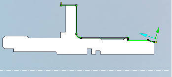
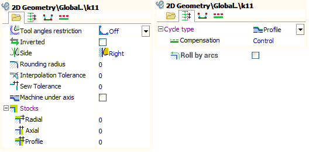
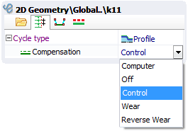
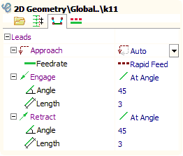
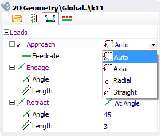
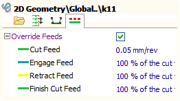
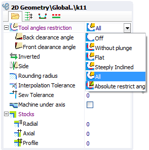
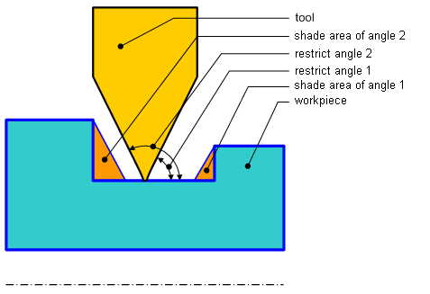
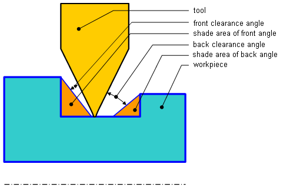

# ジョブ割り当て要素パラメータ

基本パラメータ：

ジョブ割り当て要素リストに輪郭を追加すると、その輪郭がグラフィックウィンドウに表示されます。

加工方向と加工面を示す矢印が、輪郭の開始点の反対側に表示されます。青い矢印を左クリックすると、加工方向を変更できます。黄色の矢印を左クリックすると、加工面を変更できます。

輪郭パラメーターウィンドウは、いずれかの矢印を右クリックするか、要素のパラメータボタンをクリックすることで表示できます。

[サイクルタイプ](10188.md)では、指定した輪郭に基づいてツールパスを生成する方法を設定します。

<strong>ラウンディング半径 -</strong> 輪郭のすべての外側の鋭角コーナーを丸める円弧の半径を指定します。この値がゼロの場合、コーナーは丸められません。

補間トレランス - 輪郭の複数の区間を円弧または直線にまとめることで輪郭を変更できます。この場合、生成される輪郭と元の輪郭との差は、指定した値以内になります。この機能は、スプライン曲線の加工に非常に便利です。

残し代 - 輪郭を径方向、軸方向、および等距離方向に移動させることができます。ストックの正方向（+）は、輪郭の加工側によって決まります。

<strong>縫合トレランス -</strong> 複数の曲線およびサーフェスから旋削母船を作成する際に使用します。

<strong>円弧でロール -</strong> ツールパスの外側コーナーに円弧を追加することで、輪郭に沿ったツールパスをより正確に設定できます。この機能は、半径の大きな工具を使用する場合に便利です。

工具半径補正モード:

補正モードが "オフ" の場合、NCプログラムは輪郭を変換せず、元の輪郭をそのまま使用します。複雑な輪郭でこのモードを使用すると、線や欠陥が発生する可能性があるため、加工シミュレーション時には注意が必要です。

補正モードが " コンピュータ " の場合、元の輪郭に対して工具先端半径に基づく等距離輪郭を生成し、その後、工具基準点へシフトしてツールパスが形成されます。通常、これにより傾斜区間のずれを引き起こし、輪郭円弧の外径は工具先端半径分だけ増加し、内径は工具先端半径分だけ減少します。また、開始点も工具先端半径分だけオフセットします。

補正モードが "制御機" の場合、NCプログラムは輪郭を変換せず、元の輪郭をそのまま使用します。補正コマンド（ISO G41/42/40）は、アプローチと退避フレームの前に挿入されます。

両補正と両補正リバースモードでは、輪郭は " コンピュータ " モードと同様に変換されます。しかし、"制御機"モードと同様に、アプローチおよび退避のフレーム前にも補正コマンドが挿入されます。両補正リバースモードは、補正方向が両補正モードとは異なります。

"マイナス軸加工" パラメータを使用すると、回転軸より下側にツールパスを生成できます。 そのため、すべての径方向座標は負の値になります。

"<strong>ラウンディング半径</strong>"が有効で、補正モードが "両補正" または "コンピュータ" の場合、輪郭の外側コーナーには、工具先端半径と等しい半径の円弧が自動生成されます。これにより、工具の移動方向の急激な変化による機械の振動を低減できる場合があります。

切込み、退避、および要素間の移行動作を設定します。

各輪郭の開始前と終了時に、それぞれ1つの特殊な要素が追加されます。これらの要素は、それぞれ「切込み」と「退避」と呼びます。工具先端半径補正を使用する場合、「切込み」は “補正スイッチオンの切削”、「退避」は “補正スイッチオフの切削” として扱われます。「切込み」と「退避」パラメータは、グラフィカルフィールド上で設定できます。ここでは、切削の終了点と長さの両方を設定できます。切込み／退避は、直線または円弧で実行できます。

画面上で選択した「切込み」をもう一度クリックすると、円弧／切削の切り替えができます。

「切込み」と「退避」パラメータは、次のウィンドウ上で設定できます。

オペレーション内に複数の要素がある場合、要素間の移動は早送りで実行されます。前の要素の最終点から次の輪郭の最初の点までのアプローチ方法は、アプローチモードによって決定されます。

軸方向モードでは、まず軸方向からアプローチし、次に径方向からアプローチします。

径方向モードでは、まず径方向からアプローチし、次に軸方向からアプローチします。

"直線" モードでは、直線による遷移が生成されます。

"自動" モード で は、前の輪郭の最終点と加工対象の輪郭の側に応じて、径方向または軸方向のアプローチが自動的に選択されます。 移動時の加工送り速度も設定できます。

送りの制御

各輪郭の加工は、デフォルトではオペレーションパラメータで設定した送り速度で行われます。

ジョブ割り当ての要素ごとに送り速度を指定する場合は、要素のパラメータウィンドウを使用します。

"送りオーバーライド" にチェックボックスがオフの場合、輪郭の送り速度はオペレーションパラメータで指定した値が使用されます。チェックボックスがオンの場合は、このウィンドウで指定した送り速度が使用されます。

工具角度の制限

溝加工では、オーバーラインや工具破損を防ぐために、工具角度の制限を考慮する必要があります。これらの角度はパラメーターウィンドウで設定できます。

工具角度制限には６つのモードがあります。

工具角度の制限 単純な輪郭の場合は、工具角度の制限はデフォルトで<strong>オフ</strong>になっています。 この場合、工具角度に基づく輪郭の補正は行われません。輪郭に溝形状が含まれる場合は、オーバーラインが発生する可能性が高くなります。

<strong>アブソリュート制限角度</strong>モードでは、実際の工具角度とは関係なく、指定した角度に基づいて輪郭を補正できます。これらの角度は水平線を基準に測定され、下図のように定義されます。

"<strong>プランジを除く</strong>" モードでは、工具が端面溝や円筒溝へプランジすることを防止できます。左側の主軸で外径溝を加工する場合、このモードは、 第1角度を0度、第2角度を90度に設定することと同等の動作になります。

"全て許可" モードでは、工具形状で許容される範囲内で、端面溝および側面の溝へプランジできます。後部クリアランス角および前部クリアランス角によって、実際の工具角度を基準とした絶対角度を設定します。

"フラット"モードでは、工具は円筒面の溝までプランジできますが、端面の溝にはプランジできません。

左側の主軸で外側の溝を加工する場合、このモードは第2アブソリュート角度を90度に設定した場合と同じ扱いになり、後部クリアランス角が使用されます。

"急傾斜"モードでは、工具は端面の溝までプランジできますが、円筒面の溝にはプランジできません。

左側の主軸で外側の溝を加工する場合、このモードは、第1アブソリュート角度を0度に設定することと同じで、前面逃げ角を使用すること同等です。
