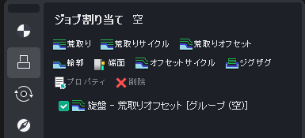
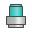
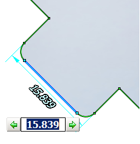
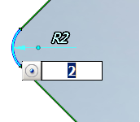

# 輪郭編集モード

輪郭編集モードの起動

輪郭編集モードを有効にするには、ジョブ割り当てに切り替え、必要に応じてジョブ割り当ての要素を追加する必要があります。

要素の左側にあるチェックボックスで、編集する必要のない要素を非表示にできます。ウィンドウ内に少なくとも1つの表示要素があり、ジョブ割り当ての表示ボタンを押すと、 輪郭編集ツールバーがグラフィックウィンドウに表示されます。 

輪郭要素の選択方法

マウスでクリックすると、セグメントまたは輪郭の頂点を選択できます。選択したオブジェクトは色で示されます。

長方形選択（長方形の最初の頂点でクリックし、2番目の頂点で離す）により、長方形内に入っているすべての要素が選択されます。

直線をダブルクリックすると、同一直線上にあるすべての直線が選択されます。

円弧をダブルクリックすると、同じ半径を持つすべての円弧が選択されます。

面取りをダブルクリックすると、同じサイズの面取りがすべて選択されます。

Ctrl "を押しながら操作すると、選択した要素と直前に選択した要素をつなぐすべての要素が選択状態になります。

輪郭編集操作

1. 頂点をドラッグして移動できます。

2. 選択した要素を等距離方向にドラッグして移動できます。この操作では、頂点ではなく要素自体を選択する必要があります。

3. 円弧の半径を変更するには、2つの方法があります。

1. 選択した円弧を新しい位置までドラッグして、円弧の半径を変更します。このとき、隣接する要素の位置が変わらないように円弧の中心が移動します。

2. 円弧をクリックして選択します。円弧の中心が表示されます。その後、隣接する要素を変更できますが、円弧の中心は固定されたままになります。

4. 選択した要素は、'Del' キーまたは ボタンで削除できます。

5. 作図要素は、 ボタンまたは 'Shift+Del' で削除できます。 選択した要素が削除され、隣接する要素同士は接続されます。

6. 面取りを追加するには、頂点を選択し、パネルの対応するボタンを押します。

7. パネル上の対応するボタンをクリックすることで、操作を元に戻したり、やり直したりできます。

寸法の正確な割り当て

要素を選択すると、寸法線が表示されます。寸法をクリックすると、正確な値を設定できます。マウスホイールを使用することもできます。要素が変更されている場合は、その要素の元の位置を基準とした寸法も表示されます。

要素を選択すると、システムは自動的に溝を認識しようとします。溝が認識されると、その幅が表示されます。緑色の矢印をクリックすると、移動する溝の側を選択できます。

円弧の半径を編集する場合、値編集フィールドのボタンをクリックすることで、変更対象（中心座標または隣接する要素）を設定できます。

