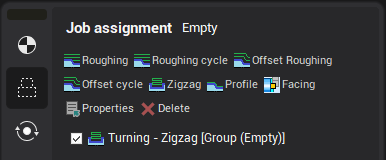
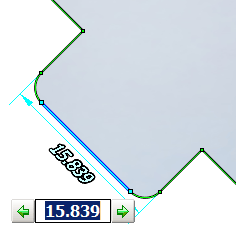
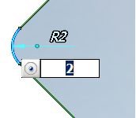

# Modos de edição de contorno

Ativação do modo de edição de contorno

Para ativar o modo de edição de contorno, abra a definição da tarefa e, se necessário, adicione um elemento à definição da tarefa.

As caixas de seleção à esquerda dos elementos permitem ocultar os elementos que não precisam ser editados. Se a janela tiver pelo menos um item visível e o botão de visibilidade da definição da tarefa estiver pressionado , a barra de ferramentas de edição de contorno aparecerá na janela gráfica .

Métodos de seleção de elementos do contorno

Um clique do mouse seleciona um segmento ou um vértice do contorno. Os objetos selecionados são destacados por cor. A seleção por retângulo (pressione o botão do mouse no primeiro vértice do retângulo e solte-o no segundo) marca todos os elementos que ficam dentro desse retângulo. Um clique duplo em uma linha seleciona todas as linhas que estão na mesma reta. Um clique duplo em um arco seleciona todos os arcos com o mesmo raio. Um clique duplo em um chanfro seleciona todos os chanfros com o mesmo tamanho. Se a tecla "Ctrl" estiver pressionada, serão marcados todos os elementos que ligam o elemento selecionado ao elemento selecionado anteriormente.

Operações de edição de contorno

1. É possível arrastar os vértices.

2. É possível arrastar os itens selecionados de forma equidistante. Para isso, é necessário selecionar elementos, e não vértices.

3. Há duas maneiras de alterar o raio de um arco. Na primeira, arraste o arco marcado para a nova posição. O centro do arco se desloca de modo que os elementos adjacentes não mudem de posição. Na segunda, marque o arco clicando nele. O centro do arco será exibido. Depois disso, é possível alterar os elementos adjacentes, mas o centro do arco permanecerá fixo.

4. É possível excluir os itens selecionados com a tecla 'Del' ou com o botão 

5. É possível excluir um elemento construtivo com o botão  ou com "Shift+Del". Os elementos selecionados serão excluídos e os elementos adjacentes serão ligados.

6. Para adicionar um chanfro, selecione o vértice e pressione o botão correspondente no painel.

7. É possível desfazer e refazer ações clicando nos botões correspondentes no painel.

Definição de dimensões exatas

Depois que um item é selecionado, as linhas de cota ficam visíveis. Clique em uma cota para definir o valor exato. Também é possível usar a roda do mouse. Se o elemento tiver sido alterado, também são exibidas as cotas em relação à posição original do elemento.

Ao selecionar um elemento, o sistema tenta reconhecer ranhuras automaticamente. Se uma ranhura for reconhecida, sua largura é exibida. É possível escolher o lado da ranhura a ser deslocado clicando nas setas verdes.

Ao editar o raio de um arco, é possível definir qual objeto será alterado (as coordenadas do centro ou os elementos adjacentes) clicando no botão do campo de edição do valor

