# Maschine einrichten

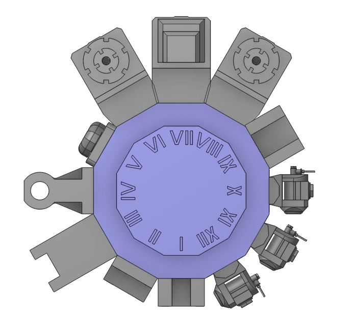

## Anwendungsbereich:

Diese Registerkarte enthält grundlegende Projektparameter, insbesondere für das kinematische Maschinenschema.

### Beschreibung.

Der Maschinenname muss eindeutig sein.

Weitere Informationen anzeigen

**Comment (Kommentar).** Beschreibung der verwendeten Maschine oder Anlage.

**Group (Gruppe).** Dient ausschließlich zur Sortierung in der Maschinenbibliothek. Verfügbar sind **Jet cutting**, **Wire EDM**, **Milling**, **Lathe**, **Turn-milling**, **Robotics** und **Other**.

**Developer (Entwickler).** Ersteller des Maschinenschemas oder Hersteller der Maschine.

**NC System name.** Name der CNC-Steuerung.

**Postprocessor file.** Pfad zur Postprozessordatei.

**Interpreter file.** Pfad zur Interpreterdatei (.snci).

**Measurements.** Messeinstellungen.

### Werkzeugausrüstung.

Parameter der Werkzeugausrüstung.

Weitere Informationen anzeigen

**Position for tool block.** Legt die Werkzeugblöcke und deren Eigenschaften an den Werkzeugpositionen fest. Positionen können mit Blöcken belegt oder leer gelassen werden.

**Visible.** Steuert die Darstellung des Werkzeugblocks. Bei aktivierter Sichtbarkeit kann auch seine Farbe geändert werden. Die Parameter entsprechen der Gruppe **Frame**.

### Steuerungsparameter.

Parameter der Maschinensteuerung.

Weitere Informationen anzeigen

**Arcs (Kreisbögen).** Einstellungen zur Bogenausgabe.

**Use arcs.** Erlaubt Kreisbögen in CLData, beispielsweise für Kreisinterpolation. Bei deaktivierter Option werden Bögen durch Geradensegmente angenähert.

**Use arcs in XY plane.** Erlaubt die Bogenausgabe in der XY-Ebene.

**Use arcs in YZ plane.** Erlaubt die Bogenausgabe in der YZ-Ebene.

**Use arcs in ZX plane.** Erlaubt die Bogenausgabe in der ZX-Ebene.

**Circles division.** Teilt Kreise bei Bedarf in Viertel- oder Halbkreise. Dies wird für bestimmte Steuerungsformate benötigt, beispielsweise Kreisinterpolation mit Radiusangabe R.

**Do not break.** Gibt Kreise ohne Aufteilung aus.

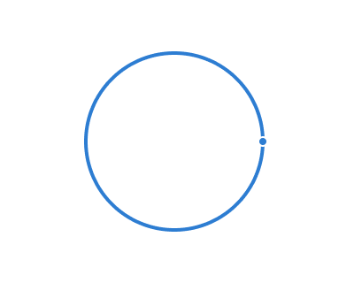

**Into quadrants.** Teilt Kreise in vier Viertelkreise.

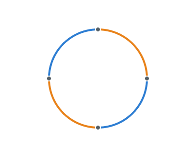

**Into halves.** Teilt Kreise in zwei Halbkreise.

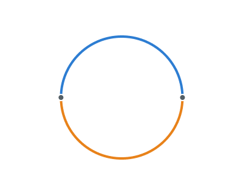

**Minimal Arc Length.** Kürzere Bögen werden durch Geradensegmente angenähert.

**Maximal Arc Radius.** Bögen mit größerem Radius werden durch Geradensegmente angenähert.

**Spatial arcs (Räumliche Kreisbögen).** Ermöglicht Bögen außerhalb der Standard-Koordinatenebenen. Dies wird häufig für Roboter zur Ausgabe von **MULTIARC** verwendet. Der Befehl beschreibt einen Kreisbogen durch drei Punkte mit jeweils vorgegebener räumlicher Werkzeugausrichtung.

**Minimal distance between start and end points.** Ist der Abstand zwischen Anfang und Ende eines räumlichen Bogens kleiner als der Grenzwert, werden stattdessen Geradensegmente erzeugt.

**Reorientation mode.** Legt die Orientierungsinterpolation am Zwischenpunkt fest: relativ zur Bahn (**relative to path**) oder zum Bezugskoordinatensystem (**relative to base CS**).

**Consider middle point orientation.** Bestimmt, ob die Orientierung am mittleren Punkt berücksichtigt wird.

**Singularities (Singularitäten).** Einstellungen zur automatischen Singularitätsvermeidung. Der rot dargestellte Singularitätsbereich tritt beispielsweise auf, wenn Werkzeugachse und Tischdrehachse zusammenfallen.

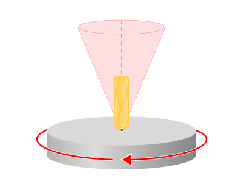

**Allowed axis deviation.** Zulässige Winkelabweichung der Maschinen- oder Roboterkomponenten von der berechneten Sollstellung, um einen Singularitätsbereich zu umgehen.

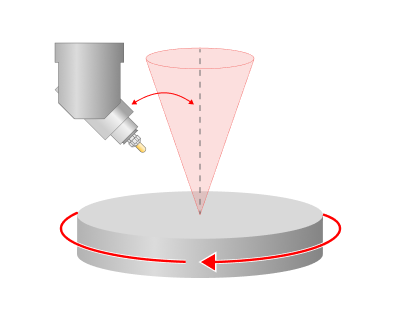

Bei Robotern können zulässige Abweichungen für **Wrist** (Handgelenk), **Elbow** (Ellenbogen) und **Base** (Basis) getrennt vorgegeben werden. Jede Gruppe besitzt einen eigenen Winkel zur Singularitätsvermeidung.

**Default machine(robot) configuration.** Standardzustand der alternativen Gelenkstellungen bzw. **Flips** gemäß Maschinenschema.

**Origin list parameters.** Einstellungen zur Kennzeichnung lokaler Koordinatensysteme.

**Origin prefix.** Präfix für die Anzeige lokaler Koordinatensysteme.

**Initial number.** Anfangsnummer der lokalen Koordinatensysteme.

**Increment value.** Schrittweite für die Nummerierung nachfolgender lokaler Koordinatensysteme.

**Create new origin for part group.** Legt fest, ob für die nächste Bauteilgruppe des betreffenden Typs automatisch ein neues lokales Koordinatensystem angelegt wird.

**Radius Compensation Parameters.** Einstellungen zur Bahnerzeugung mit Werkzeugradiuskorrektur.

**Sharp Corner.** Grenzwinkel, bis zu dem eine Konturecke bei der Radiuskorrektur als scharf behandelt wird. Für solche Ecken verwendet das System besondere Verfahren zur Bahnerzeugung.

**Rotary Transformations.** Legt fest, welche Rotationstransformationen auf der Registerkarte **Transformations** verfügbar sind.

**Polar interpolation is available.** Gibt polare Interpolation unter **Transformations → Rotary Transformation** frei. Sie ersetzt bei einer 3-Achsen-Fräsbewegung eine Linearachse durch eine Drehachse, beispielsweise bei Drehmaschinen mit angetriebenem Werkzeug oder Rotationsbearbeitung auf 4-/5-Achsen-Maschinen.

**CNC supports polar interpolation.** Gibt dort die Option **CNC interpolation** frei. Damit können die Befehle zum Ein- und Ausschalten der polaren Interpolation ausgegeben werden.

**Cylindrical interpolation is available.** Gibt zylindrische Interpolation unter **Transformations → Rotary Transformation** frei. Die Zylindermantelfläche wird über abgewickelte Kurven programmiert. Deren [X,Y,Z]-Koordinaten werden in [X,C,Z] für die Maschine umgerechnet.

**CNC supports cylindrical interpolation.** Gibt die Option **CNC interpolation** frei, um Befehle zum Ein- und Ausschalten der zylindrischen Interpolation auszugeben.

**Start from C=0.** Aktiviert gleichnamige Vorgabe unter **Transformations → Rotary Transformation**. Die Drehachse wird vor dem Einschalten polarer oder zylindrischer Interpolation auf null positioniert.

**Tool frame output.** Ausgabeformat der Werkzeugorientierung in CLData-Befehlen für 5-Achsen-Bewegungen.

**Additional transformation.** **Base coordinate system** legt das Bezugssystem der Transformation fest: Tool CS, Workpiece CS, Global CS oder ein zuvor erstelltes Geometriekoordinatensystem. Zusätzliche Verschiebung und Drehung werden in derselben Parametergruppe definiert.

**Set machine state flags.** Die Zuordnung zwischen kartesischen Koordinaten und physischen Roboterachsen hängt auch von den alternativen Gelenkstellungen ab. Diese Option steuert die Ausgabe entsprechender Flip-Kennzeichen in CLData.

**Swap Tool and Workpiece frames.** Vertauscht Werkzeug- und Werkstückkoordinatensystem, wenn der Roboter das Werkstück statt des Werkzeugs hält. Aktivieren Sie die Option, wenn die Robotersteuerung diese Transformation nicht selbst unterstützt.

**Set tool contact surface normal vectors.** Für 5-Achsen-Radiuskorrektur wird das Werkzeug vom Kontaktpunkt entlang der Flächennormalen versetzt. Bei Aktivierung wird vor jeder Bewegung **TLContact** mit den Normalenparametern am Werkzeug-Werkstück-Kontakt ausgegeben. [Details](102266.md)

**Prefer GOTO for linear movements.** Bevorzugt **GOTO** statt **MULTIGOTO**, wenn eine Bewegung ausschließlich die geometrischen Linearachsen X, Y und Z betrifft.

**Indexed 5-axis machining.** Einstellungen und Koordinatentransformationen für indexierte 5-Achsen-Bearbeitung.

**Indexed 5Axis compensation mode.** Aktiviert Rotationstransformationen für indexierte Bearbeitung auf geschwenkten Ebenen. Das Koordinatensystem wird passend zu Drehachsbewegungen neu berechnet, damit die Programmierung auf die geneigte Arbeitsebene bezogen bleibt. Diese Einstellungen dienen Steuerungen ohne eigene Schwenkebenenfunktionen wie Siemens CYCLE800, Heidenhain PLANE/Cycle 19 oder Fanuc G68.2 und ohne TCPM/RTCP. In diesem Fall berechnet das CAM-System die Transformation, die der Postprozessor in das NC-Programm übernimmt. Unterstützt die Steuerung diese Funktionen selbst, übernimmt sie die Transformation.

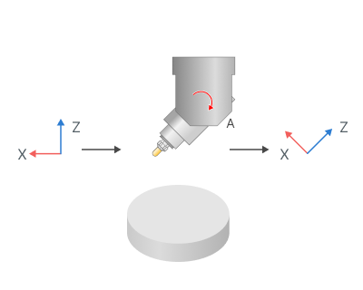

**5 Axis tooling point compensation.** Berücksichtigt das Mitdrehen des Werkzeugbezugspunkts mit dem Schwenkkopf.

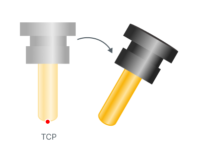 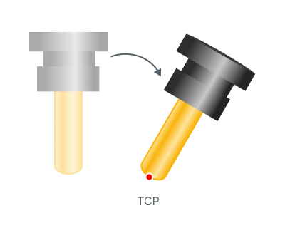

**5 Axis workpiece zero point compensation.** Der Werkstücknullpunkt dreht sich mit dem Rundtisch. Nur seine Position folgt dem Tisch; die Achsrichtungen bleiben am Maschinenkoordinatensystem ausgerichtet.

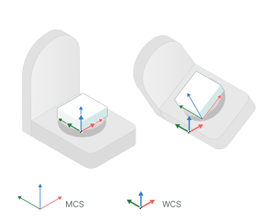 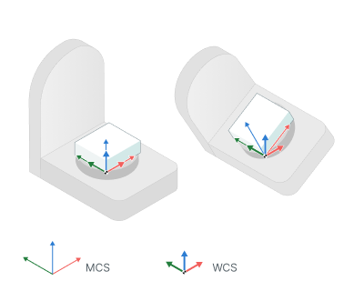

**MCS** — Maschinenkoordinatensystem

**WCS** — Werkstückkoordinatensystem

**5 Axis coordinate system compensation.** Die Achsrichtungen des Werkstückkoordinatensystems drehen sich mit dem Rundtisch. Der Ursprung bleibt dabei unverändert.

 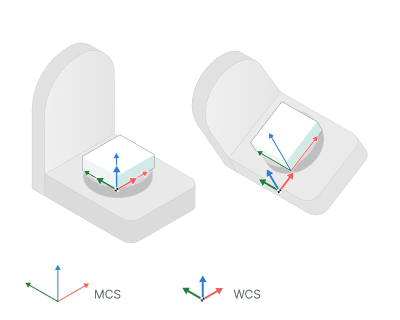

**MCS** — Maschinenkoordinatensystem

**WCS** — Werkstückkoordinatensystem

**Local coordinate system (ORIGIN).** Bestimmt die Verfügbarkeit und Vorgabe von **Local CS** auf der Registerkarte **Setup** der Operationen.

**Unavailable.** Blendet **Local CS** aus.

.Unavailable.png)

**Off.** Zeigt **Local CS** mit der Vorgabe **Off** an.

.off.png)

**Auto.** Zeigt **Local CS** mit der Vorgabe **Auto** an. Das Werkstückkoordinatensystem wird so gedreht, dass seine Z-Achse der Werkzeugachse entspricht. Der Ursprung bleibt am gewählten Bauteilpunkt.

.Auto.png)

**Local CS positioning mode.** Verhalten der physischen Maschinenachsen bei Rotationstransformationen.

**Stay.** Dreht nur das Koordinatensystem, ohne Maschinenachsen zu bewegen.

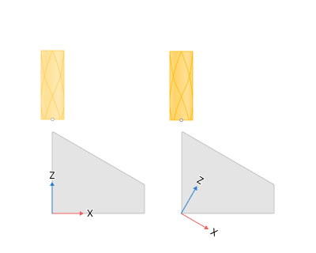

**Turn.** Dreht Koordinatensystem und Maschinen-Drehachsen. Der daraus entstehende Versatz von Werkzeugbezugspunkt und Koordinatenursprung wird nicht durch Linearachsbewegungen ausgeglichen.

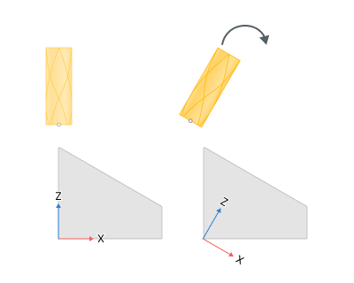

**Move.** Dreht Koordinatensystem und Maschinen-Drehachsen und gleicht den Versatz durch Linearachsbewegungen aus.

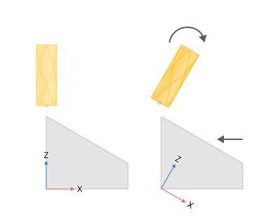

**Is spatial.** Wählt zwischen räumlichen Winkeln und Maschinen-Drehachsen zur Beschreibung der Transformation. Bei Aktivierung werden räumliche Winkel verwendet.

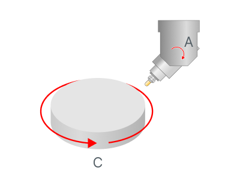 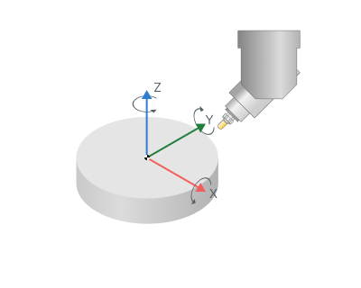

**Euler angles type (rotation sequence).** Drehreihenfolge bei Transformationen über räumliche Winkel.

**Rotations around movable axes.** Bei Aktivierung erfolgt jede weitere Drehung um die bereits mitgedrehten Koordinatenachsen. Andernfalls werden feste Achsen verwendet.

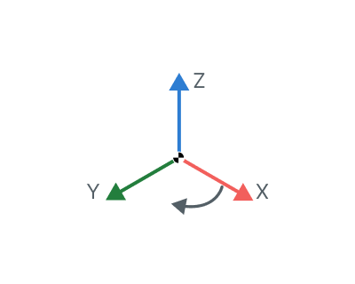 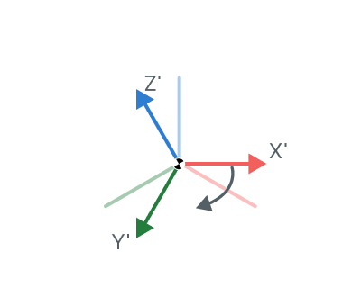

**Angles in degrees.** Aktiviert Winkelangaben in Grad. Andernfalls werden Radiant verwendet.

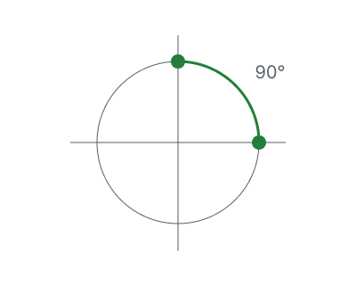 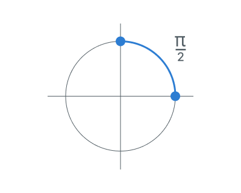

**Move auto LCS with table.** Bestimmt die Lage des Werkstückkoordinatensystems bei **Auto Local CS**. Bei Aktivierung folgt es dem Bauteil und richtet seine Z-Achse an der Werkzeugachse aus. Andernfalls bleibt es an seiner ursprünglichen Position und bewegt sich nicht mit dem Werkstück.

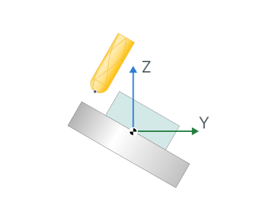 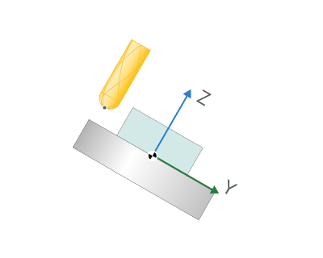

**Auto LCS rotation law.** Ausrichtungsregel für automatische lokale Koordinatensysteme bei Fräsoperationen.

**Snap to Tool CS.** Bindet die Achsrichtungen an das Werkzeugkoordinatensystem. Geeignet, wenn die Drehbewegungen durch das Werkzeug ausgeführt werden.

**Snap to Machine CS.** Bindet die Achsrichtungen an das feste Maschinenkoordinatensystem.

**Snap to Workpiece CS.** Bindet die Achsrichtungen an das Werkstückkoordinatensystem. Geeignet, wenn das Werkstück die Drehbewegungen ausführt.

**Exclude Spatial Angle A.** Hält bei Rotationstransformationen die Werkstück-X-Achse parallel zur Maschinen-X-Achse.

**Exclude Spatial Angle B.** Hält die Werkstück-Y-Achse parallel zur Maschinen-Y-Achse.

**Exclude Spatial Angle C.** Hält die Werkstück-Z-Achse parallel zur Maschinen-Z-Achse.

**Turn Auto LCS rotation law.** Ausrichtungsregel für automatische lokale Koordinatensysteme bei Drehoperationen.

**Z along turn axis, X along tool.** Z liegt entlang der Werkstückdrehachse, X zeigt zum Werkzeug.

**Z along turn axis, -X along tool.** Z liegt entlang der Werkstückdrehachse, die negative X-Richtung zeigt zum Werkzeug.

**Z along tool, X by snap rule.** Z liegt entlang der Werkzeughauptachse. X und Y werden gemäß **Auto LCS rotation law** ausgerichtet.

**Rotatable Workpiece CS.** Erlaubt unter **Setup → WCS** sowohl Verschiebung als auch Drehung des Werkstückkoordinatensystems.

**Continuous 5-axis machining.** Einstellungen und Koordinatentransformationen für kontinuierliche 5-Achsen-Bearbeitung.

**TCPM mode is available.** Gibt **Tool center point management** auf **Setup** frei. Nur für Steuerungen verwenden, die diese Funktion unterstützen. Ohne Aktivierung gelten die Transformationseinstellungen von **Indexed 5Axis compensation mode**.

**TCPM mode default state.** Legt fest, ob **Tool center point management** auf **Setup** standardmäßig aktiviert ist.

**Disable TCPM when rotate back.** Gibt die Option zum Ausschalten von TCPM beim Zurückdrehen des Werkstücks während einer Verbindung frei.

**TCPM 5Axis compensation mode.** Koordinatentransformationen für jeden NC-Satz bei kontinuierlicher 5-Achsen-Bearbeitung.

**5 Axis tooling point compensation.** Berücksichtigt das Mitdrehen des Werkzeugbezugspunkts mit dem Schwenkkopf.

**5 Axis workpiece zero point compensation.** Berücksichtigt das Mitdrehen des Werkstücknullpunkts mit dem Rundtisch.

**5 Axis coordinate system compensation.** Berücksichtigt das Mitdrehen des Werkstückkoordinatensystems mit dem Rundtisch.

**Tool Change (Werkzeugwechsel).** Einstellungen zum Verhalten beim Werkzeugwechsel.

Weitere Informationen anzeigen

**Go to tool change position.** Legt fest, wann die Werkzeugwechselposition angefahren wird.

**Only if tool change is needed.** Fährt nur zurück, wenn die nächste Operation ein anderes Werkzeug benötigt. Bei gleichem Werkzeug entfällt die Rückfahrt am Operationsende.

**Always in the end of operation.** Fährt nach jeder Operation zur Werkzeugwechselposition, unabhängig vom nächsten Werkzeug.

**Never.** Keine Rückfahrt zur Werkzeugwechselposition.

**Output mode.** Ausgabeart der Rückfahrt zur Werkzeugwechselposition im NC-Programm.

**Tool tip coordinates.** Gibt den Werkzeugbezugspunkt relativ zum Werkstückkoordinatensystem als Wechselposition aus.

**Reference point (ISO G28).** Fährt den Referenzpunkt mit **G28** an.

**Machine coordinates (ISO G53).** Verwendet **G53** zur Anfahrt der Wechselposition in Maschinenkoordinaten.

**Tool change position.** Koordinaten der Werkzeugwechselposition.

**Heavy axes.** Achsadressen, deren Bewegung beim Anfahren oder Verlassen der Werkzeugwechselposition möglichst vermieden werden soll. Die automatische Berechnung mit Kollisionsvermeidung berücksichtigt diese Priorität bei der Wahl der Achsbewegungen.

**Tool change time calculation.** Verfahren zur Berechnung der Werkzeugwechselzeit:

**Default law.** Verwendet die Standardregel des Projekts.

**Undefined.** Verwendet die im Berechnungsverfahren fest vorgegebene, nicht änderbare Werkzeugwechselzeit.

**Constant time.** Verwendet die unter **Constant Time** manuell eingetragene Dauer.

**Advanced laws.** Ermöglicht mehrere auswählbare Berechnungsregeln. Die angegebene Anzahl bestimmt die Zahl der Einträge; jeder kann eines der zuvor beschriebenen Verfahren verwenden.

**Rapid movements time calculation method.** Verfahren zur Zeitberechnung von Eilgangbewegungen.

**Maximum axis movement time (default).** Berechnet die Fahrzeit jeder Linear- und Drehachse. Die längste dieser Zeiten bestimmt die Dauer der gesamten Bewegung.

**Time of tool tip movement.** Berechnet die Dauer aus der tatsächlichen Bewegung der Werkzeugspitze und der vektoriellen Überlagerung der Geschwindigkeiten entlang X, Y und Z.

### Kühlmittel.

Parameter zur Kühlmittelverwendung im Projekt.

Weitere Informationen anzeigen

Für alle Kühlmittelarten stehen folgende Eigenschaften zur Verfügung:

**ID.** Kennung der Kühlmittelzufuhr.

**Tube name.** Name des Kühlmittelkanals.

**Icon file.** Dateiverweis für die Darstellung des Kühlmittelkanals.

**Switch time.** Zeit zum Einschalten der Kühlmittelzufuhr.

### Simulation.

Einstellungen für die Projektsimulation und deren Rechenaufwand.

Weitere Informationen anzeigen

Ein Teil der Parameter entspricht dem Panel [Setup](1022.md).

**Simulation Method.** Verfahren zur Berechnung und Darstellung der Simulation.

**Solid.** Verwendet ein netzbasiertes Volumenmodell. Benötigt mehr Rechenleistung, ermöglicht aber eine höhere Darstellungsqualität bearbeiteter Flächen.

**Voxel5d.** Verwendet räumliche Voxel für komplexe Volumenmodelle und benötigt entsprechend Ressourcen. Für 3-Achsen-, Dreh- und mehrachsige Operationen geeignet.

**Voxel3d.** Verwendet säulenförmige Voxel. Berechnet schneller, ist jedoch auf 3-Achsen-Operationen beschränkt.

**Model resolution.** Auflösung des Simulationsmodells. Sie bestimmt die Voxelunterteilung des Rohteils. Eine höhere Auflösung verbessert die Darstellung.

**Gouge detection tolerance.** Mindesttiefe eines Einschnitts, ab der eine Bauteilverletzung gemeldet wird. Kleinere Abweichungen bleiben unberücksichtigt.

**Revolution bodies simulation.** Stellt bei Drehprojekten beispielsweise Spannbacken als gemeinsamen Rotationskörper dar. Kollisionen mit anderen Maschinenkomponenten werden gegen diesen Körper geprüft. Die Aktivierung erhöht den Simulationsaufwand.

**Check inappropriate tool and spindle direction.** Prüft, ob die Spindeldrehrichtung zum Werkzeug passt, beispielsweise zu einem rechtsschneidenden Fräser. Beim Drehen wird zusätzlich die Werkzeuganordnung berücksichtigt.

**Collisions to ignore.** Legt Komponentenpaare fest, die von der Kollisionsprüfung ausgeschlossen werden. Dadurch lassen sich unerwünschte Kollisionsmeldungen zwischen diesen Komponenten vermeiden. Das Einrichten in MachineMaker ist beispielsweise in der [Roboterdokumentation](https://docs.encycam.com/MachineMaker/1/robots/en/46.html) beschrieben.

**Show active part only.** Zeigt nur das aktuelle Bauteil. In Mehrteilprojekten bestimmt die Auswahl im Baum, welches Bauteil bzw. welche zugehörige Operation aktiv ist. Dies reduziert den Rechenaufwand beispielsweise in Technologie- und Simulationsansichten.

### Systemeinstellungen.

Weitere Informationen anzeigen

**Rotation angles (rotation sequence).** Regeln zur Anwendung räumlicher Drehwinkel bei lokalen Koordinatensystemen.

**Rotations sequence.** Reihenfolge der Drehungen um die Koordinatenachsen.

**Rotations around movable axes.** Bei Aktivierung erfolgt jede weitere Drehung um die bereits gedrehten Koordinatenachsen; andernfalls um feste Achsen.

**Angles in degrees.** Verwendet Grad als Winkeleinheit.

### Maschinenzustandsparameter.

Dieser Abschnitt enthält die Parameter der einzelnen Maschinenachsen. Das Kontrollkästchen bei der Achsbezeichnung bestimmt, ob die Achse auf **Setup** in der Achsliste der Operationen angezeigt wird.

Weitere Informationen anzeigen

**Address.** Achsadresse für die Ausgabe im NC-Programm.

**Axis Control.** Bewegungssteuerung der Achse.

**Continuous.** Kontinuierlich gesteuerte Achse.

**Indexed.** Achse mit diskreten Positionierschritten.

**Manual.** Die Achsposition kann nur manuell geändert werden.

**Force control with map.** Ermöglicht die Vorgabe des Achsverlaufs über den Achsenplan. [Details](1022.md).

**Group.** Zuordnung zu **Rotary axes**, **Linear axes** oder **Others**.

**Increment.** Kleinster vom Achsantrieb ausführbarer Positionierschritt.

**Min.** Untere Verfahrgrenze.

**Max.** Obere Verfahrgrenze.

**Initial value.** Standardposition der Komponente.

**Design time value.** Versatz zur Anpassung des Verfahrbereichs **Min–Max**.

**Axis has brake.** Aktiviert die Ausgabe von Bremssteuerbefehlen in CLData.

**Priority.** Priorität der Anzeige unter **Machine State Parameters**. Kleinere Werte platzieren die Achse weiter oben.

**Order.** Laufende Position der Achse in der Liste **Machine State Parameters**.

**Support shortest path rotation.** Gibt an, ob die Drehachse den kürzesten Weg zwischen Anfangs- und Endstellung im Raum verwenden kann.

### Komponentenbaum.

Dieser Abschnitt beschreibt die hierarchische Verbindung der Maschinenkomponenten. Jede bewegliche Komponente besitzt einen Namen und eine Kennung ihrer Bewegungsachse.

Weitere Informationen anzeigen

**Visible.** Blendet die Komponente ein oder aus. Bei sichtbarer Komponente kann ihre Farbe geändert werden.

**Metallic.** Stellt die Komponentenoberfläche mit metallischem Glanz dar.

**Transparent.** Aktiviert Transparenz mit einstellbarem Grad.

**Display mode.** Darstellungsmodus des 3D-Modells. Standardmäßig gilt der Modus des Grafikfensters; für die Komponente kann ein eigener Modus festgelegt werden. [Details](169.md)

**Channel.** Steuerungskanal für die Achse dieser beweglichen Komponente.

**Workpiece index.** Ordnet die Achse dem Werkstück mit der angegebenen Nummer zu.

**Rapid feed.** Eilganggeschwindigkeit: mm/min bei Linearachsen und Grad/min bei Drehachsen.

**Scale.** Maßstab der Komponentendarstellung.

**Inverse rotation direction.** Kehrt die Spindeldrehrichtung um.

**ID of rotary axis that is used as spindle.** Kennung der als Spindel verwendeten Drehachse an einer Werkzeug- oder Werkstückaufnahme.

**Default clamp ID.** Kennung der standardmäßig verwendeten Spannvorrichtung dieser Aufnahme.

**Supported applications.** Unterstützte Werkzeug- bzw. Anwendungskategorien der Aufnahme.

### Teilmaschinen.

**Submachine** beschreibt die Parameter eines Paars aus Werkzeug- und Werkstückhalter. Dies ist insbesondere für Maschinen mit mehreren Spindeln oder Werkstückpositionen relevant. [Details](10410.md).

### Standardmodus für die Operationsreihenfolge.

Diese Parameter bestimmen, ob und wie die Reihenfolge der Operationen geändert werden kann. [Details](1029.md).

Weitere Informationen anzeigen

**No reordering.** Deaktiviert das Umordnen der Operationsfolge.

**Minimize tool changes.** Optimiert bei mehreren Bauteilen die tatsächliche Bearbeitungsfolge zur Verringerung der Werkzeugwechsel.

**Swiss lathe (takeover last).** Stellt die Operationen des zweiten Bauteils an den Anfang der umgeordneten Liste.

### Maschinenabmessungen.

Diese Parameter definieren geometrische Beziehungen und Versätze innerhalb der Maschine bzw. zwischen Komponenten einer Roboteranlage. Vorgaben werden in MachineMaker festgelegt und können in der Kinematikdatei überschrieben werden.