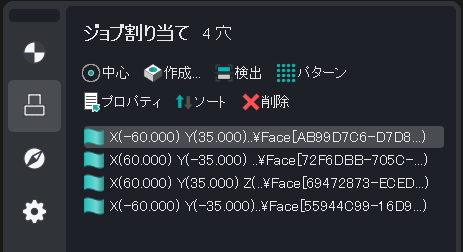
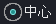
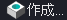
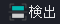
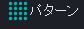
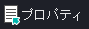
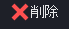
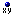
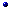

# 穴加工のジョブ割り当て

-  - 中心点で穴を開ける
-  - 座標入力による穴の作成
-  - パーツの穴を自動的に認識
-  - パターンによる穴の配列の作成
-  - 選択されたアイテムのプロパティ
-  - 選択したアイテムを削除

[穴加工オペレーション](10100.md)のパラメータを設定する際には、加工対象となる穴のデータを定義することができます。穴加工オペレーションでは、穴リストによって加工する穴の数、順序、および各パラメータが定義されます。順序はマウスドラッグで変更することができます。

各穴は、その中心座標、直径、さらに上部高さおよび底部高さの値によって定義されます。穴の中心座標の定義方法には、座標を直接指定する方法と、幾何学的な「点」オブジェクトを使用する方法の2種類があります。

中心の定義方法に関わらず、穴の深さは`モデル`ページ上で直接定義されます。座標によって指定された穴は、 の記号で表示され、点によって定義された穴は、 のアイコンで表示されます。上部および底部高さを定義するには、右側のリストから目的の点を選択し、`Z最大`および`Z最小`の値を入力する必要があります。

穴加工オペレーションでは、各穴中心ごとにドリル方向を指定する方法が2通り用意されています。ジョブ割り当てダイアログウィンドウの`反転`フィールドを使用する方法、またはグラフィックウィンドウ上で法線方向を指定する方法です。

- `Z最大` 穴の上面のZ座標を定義します。この座標は直接指定することも、自動計算することも可能です。自動計算の場合、ワークへの進入はワークからの安全距離を使用して行われます。
- `Z最小` 穴の底面のZ座標を定義します。この座標は直接指定することも、自動計算することも可能です。自動計算の場合、その座標は加工対象モデルから取得されます。

`Z最小`パラメータに加えて、オペレーションには`ドリル先端補正`パラメータを指定することができます。このパラメータは以下のいずれかとなります。

- `オフ` – ドリル先端が`Z最小`高さまで下降します。
- <ドリル先端- ドリルは`Z最小`高さより下でドリルのテーパー部分の値まで下降し、従って`Z最小`高さまでの円筒状の穴加工領域が確保されます。
- `長さ` – ドリルの上端が`Z最小`高さを超えて、指定された値まで下降します。

穴リストで穴を選択し、メニューの`DXFで選択したデータをエクスポート`項目を使用して、選択した内容をDXFファイルにエクスポートします。

異なるパラメータ値を持つ穴をソートするには、`ソート`を使用してください。
