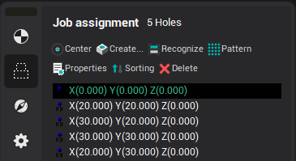
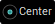
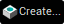
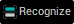
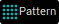
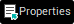
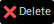
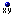
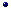

# Atribuição de trabalho da operação de usinagem de furos

-  - Criar furo por ponto central
-  - Criar furo por entrada de coordenadas
-  - Reconhecer automaticamente os furos na peça
-  - Criar matriz de furos por padrão
-  - Propriedades dos itens selecionados
-  - Excluir itens selecionados

Ao definir os parâmetros da [operação de usinagem de furos](10100.md), é possível definir os dados dos furos a serem perfurados. Na operação de usinagem de furos, a lista de furos define o número, a sequência e os parâmetros dos furos a serem usinados. A ordem pode ser alterada arrastando o mouse.

Cada furo é definido pelas coordenadas de seu centro, o diâmetro e também o valor dos níveis superior e inferior. Há dois métodos para definir as coordenadas centrais dos furos: por coordenadas ou por um objeto geométrico de "ponto".

Independentemente do método de definição de centro usado, a profundidade do furo é definida diretamente na página **Model**. Os furos especificados por coordenadas são marcados com o sinal , enquanto os furos definidos por ponto central são marcados com o ícone . Para definir os níveis superior e inferior, é necessário selecionar os pontos desejados na lista à direita e inserir os valores **Zmax** e **Zmin**.

A operação de usinagem de furos suporta duas maneiras de especificar a direção da perfuração para cada centro de furo. Use o campo **Inverse** da caixa de diálogo Job Assignment ou especifique a normal na janela gráfica.

- **Zmax** - define a coordenada Z da parte superior do furo. A coordenada pode ser definida diretamente ou calculada automaticamente. Ao calcular automaticamente, a transição para o avanço de trabalho é realizada usando a distância de segurança em relação ao bruto.
- **Zmin** - define a coordenada Z da parte inferior do furo. A coordenada pode ser definida diretamente ou calculada automaticamente. Ao calcular automaticamente, a coordenada é obtida do modelo que está sendo usinado.

Além do parâmetro **ZMin**, a operação pode ter o parâmetro **Drill tip compensation** especificado. Esse parâmetro pode ser um dos seguintes:

- **Off** - a ponta da broca desce até o nível **ZMin**.
- **Drill tip** - a broca desce abaixo do nível **ZMin** até o valor da parte cônica da broca, proporcionando assim uma área de perfuração cilíndrica até a profundidade **ZMin**.
- **Length** - a ponta da broca desce abaixo do nível **ZMin** até o valor especificado.

Selecione os furos na lista de furos e use o item do menu de contexto **Export selected in DXF** para exportar a lista para um arquivo DXF.

Para classificar os furos com valores de parâmetros diferentes, use a opção **Sorting**.
