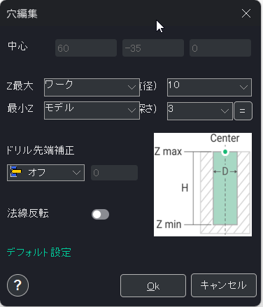
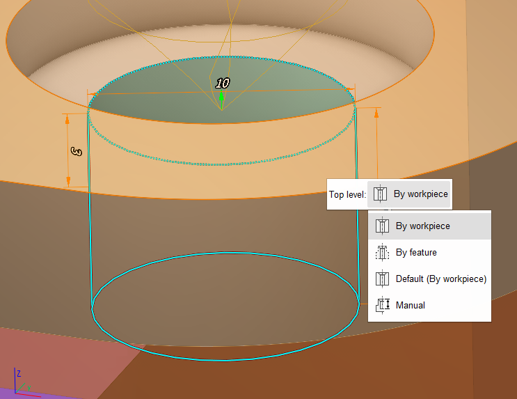
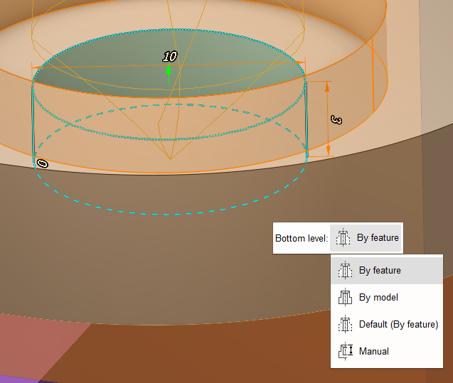

# 座標による穴の定義

開いたウィンドウは、新規または既存の穴のパラメータ割り当て用に設計されています。既存の穴のパラメータを編集するには、リストから対象の穴をダブルクリックします。

穴を作成するには、パラメータ（位置、直径、深さ）の値を設定し、**Ok**ボタンをクリックします。作成された穴は自動的にリストに追加されます。

穴のパラメータを変更すると、その変更内容がグラフィックウィンドウに表示されます。

`Z最大` - 上部高さモード：

- `ワーク` - 上部高さは、工具の移動経路に沿ったワークエッジの最も高い座標として定義されます。
- `フィーチャー` -上部高さは、<strong>ジョブ割り当て</strong>として選択された幾何要素において、工具の移動経路に沿った最も高い座標として定義されます。
- `デフォルト` – 括弧内は、`デフォルト設定`ウィンドウで選択されているデフォルト値を示します。
- `手動` – ユーザーが手動で値を設定します。

`Z最小` - 底部高さモード:

- `フィーチャー` -底部高さは、<strong>ジョブ割り当て</strong>として選択されたモデル要素の中で、工具進行方向に沿った最も遠い座標として定義されます。
- `モデル` - 底部高さは、工具の移動方向において、部品上の穴位置の最も遠い座標によって決定されます。
- `デフォルト` – 括弧内は、`デフォルト設定`ウィンドウで選択されているデフォルト値を示します。
- `手動` – ユーザーが手動で値を設定します。

`ドリル先端補正` - 穴の深さの指定方法を選択します。

- `オフ` – 最後のツールパス点が、ドリル工具の位置と一致します。
- `ドリル先端` – 最後のツールパス点が、ドリル先端位置と一致します。
- `長さ` – `オフ` と同様ですが、ドリルは工具基準点から指定された値だけ下方向へ移動します。
- `自動` – 穴の深さは、穴が止まり穴か貫通穴かに応じて、システムによって定義されます。

`デフォルト設定`ボタンをクリックすると、`Z最大`と`Z最小`のデフォルト値を設定するウィンドウが開きます。これらの設定は、 現在のプロジェクトだけでなく、システム全体に適用されます。

また、グラフィックウィンドウ上で`Z最大`および`Z最小`のモードを設定することもできます。上部高さまたは底部高さをクリックすると、アクションメニューが表示されます。各モードはそれぞれ異なる表示で示されます。

 
