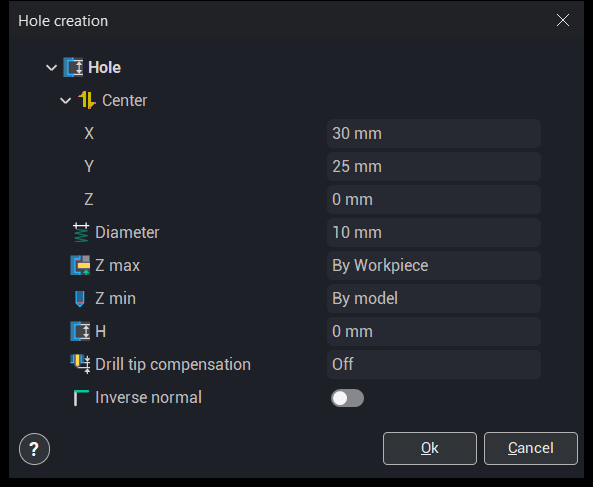
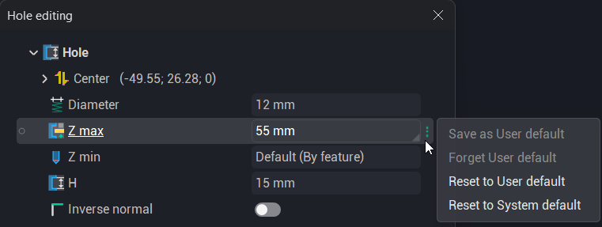
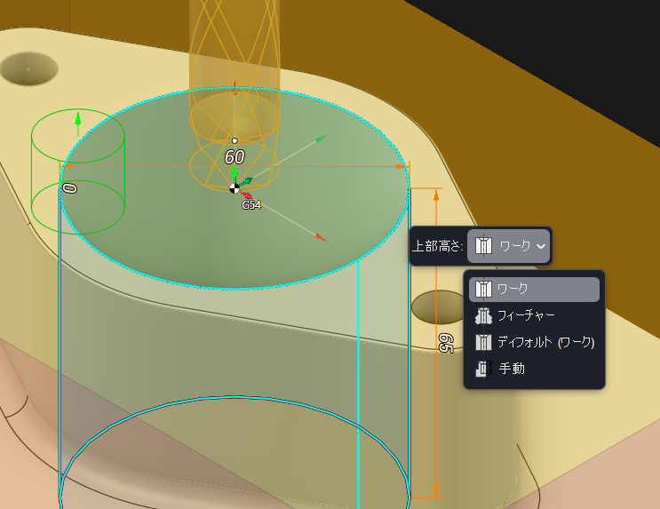
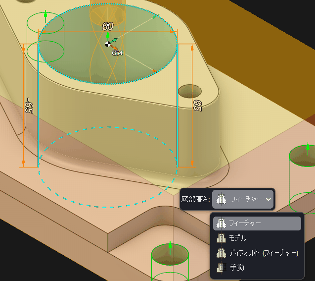

# Defining holes by coordinates

The window that opens is designed for parameter assignment of new or existing holes. The **Create** command opens the **Hole creation** window. To edit the parameters of an existing hole, double click the required hole in the list or use the **Properties** command: the **Hole editing** window opens. [Details](10212.md)

To create a hole the user should define the values of its parameters (position, diameter, depth) and press the **Ok** button. The created hole will be automatically added to the list.

When hole's parameters are being altered, the changes are displayed in the graphic window.

**Center.** Coordinates **X**, **Y** and **Z** of the hole center.

**Diameter.** Diameter of the hole.

**Z max** - top level mode:

- **By workpiece** - the top level is defined as the highest coordinate of the workpiece edge along the tool travel path;
- **By feature** -the top level is defined as the highest coordinate of the geometric element selected as the **Job Assignment** along the tool travel path;
- **Default** – the default mode is used; parentheses indicate this mode. See the default settings below;
- **Manual** – user set value manually.

**Z min** - bottom level mode:

- **By feature** -the bottom level is defined as the most remote coordinate of the geometric element selected as the **Job Assignment** along the tool travel path;
- **By model** - the bottom level is determined by the most remote coordinate of the hole position on the part in the tool travel direction;
- **Default** – the default mode is used; parentheses indicate this mode. See the default settings below;
- **Manual** – user set value manually.

**H.** Depth of the hole: the distance between **Z max** and **Z min**. It is set as a length or in % of the hole diameter (**% D**).

**Drill tip compensation** - choose the way the hole depth is specified:

- **Off** – last tool path point matches the drill tooling point;
- **Drill tip** – last tool path point matches the drill tip point;
- **Length** – same as **Off** but the drill travels the specified value down from the drill tooling point.

**Inverse normal.** Reverses the drilling direction of the hole. The direction of an existing hole is changed in the **Hole editing** window.

To change the default modes of **Z max** and **Z min**, hover over the **Z max** or **Z min** line and click the **...** button on the right. The menu contains the following commands:

- **Save as User default** – the current mode of the level becomes the default mode. Available when the level uses a mode that can be the default: **By Workpiece** or **By feature** for **Z max**, **By feature** or **By model** for **Z min**;
- **Forget User default** – the default mode returns to the system default;
- **Reset to User default** – sets the **Default** mode for the level;
- **Reset to System default** – sets the system default mode for the level.

Commands that do not change anything are unavailable. These settings will be applied for the whole system, not just for a current project.

Also you can set **Z max** and **Z min** mode in graphics window. Click on top or bottom level and you see action menu. Each mode is displayed differently:

 
