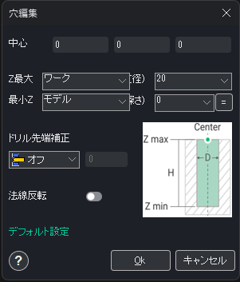

# Definição de furos por objeto de ponto geométrico

A janela que se abre foi projetada para a atribuição de parâmetros de furos novos ou existentes. Para editar os parâmetros de um furo existente, clique duas vezes no furo desejado na lista.

Para criar um furo, o usuário deve definir os valores de seus parâmetros (posição, diâmetro, profundidade) e pressionar o botão **Ok**. O furo criado será automaticamente adicionado à lista.

Quando os parâmetros do furo estão sendo alterados, as alterações são exibidas na janela gráfica.
