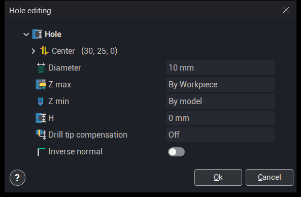
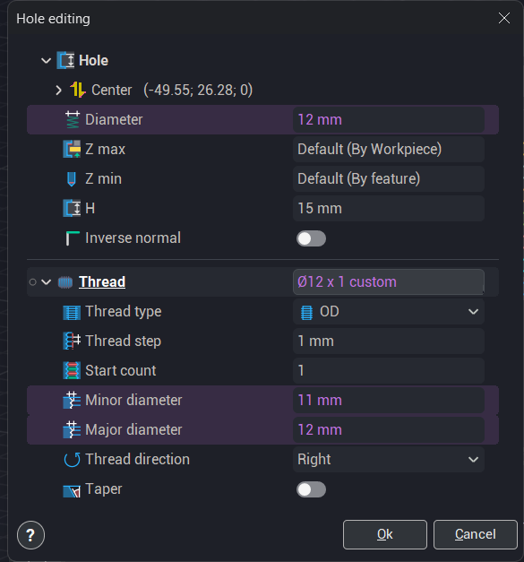

# Defining holes by using a geometrical point object

The window that opens is designed for parameter assignment of new or existing holes. To edit the parameters of an existing hole, double click the required hole in the list or use the **Properties** command: the **Hole editing** window opens.

To create a hole the user should define the values of its parameters (position, diameter, depth) and press the **Ok** button. The created hole will be automatically added to the list.

When hole's parameters are being altered, the changes are displayed in the graphic window.

The **Hole editing** window contains the same parameters as the **Hole creation** window. [Details](10211.md) The coordinates of the hole center are shown in one line as *(X; Y; Z)*. Expand the line to edit them.

To edit several holes at once, select them in the list and use the **Properties** command. If the selected holes have different values of a parameter, the parameter is highlighted in purple. A value entered in the window is applied to all selected holes.

