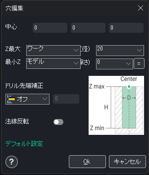

# 点要素を使った穴の定義

開いたウィンドウは、新規または既存の穴のパラメータ割り当て用に設計されています。既存の穴のパラメータを編集するには、リストから必要な穴をダブルクリックします。

穴を作成するには、ユーザーはパラメータ（位置、直径、深さ）の値を設定し、**Ok**ボタンをクリックします。作成された穴は自動的にリストに追加されます。

穴のパラメータを変更すると、その変更内容がグラフィックウィンドウ上に表示されます。
