# 穴パターンの作成

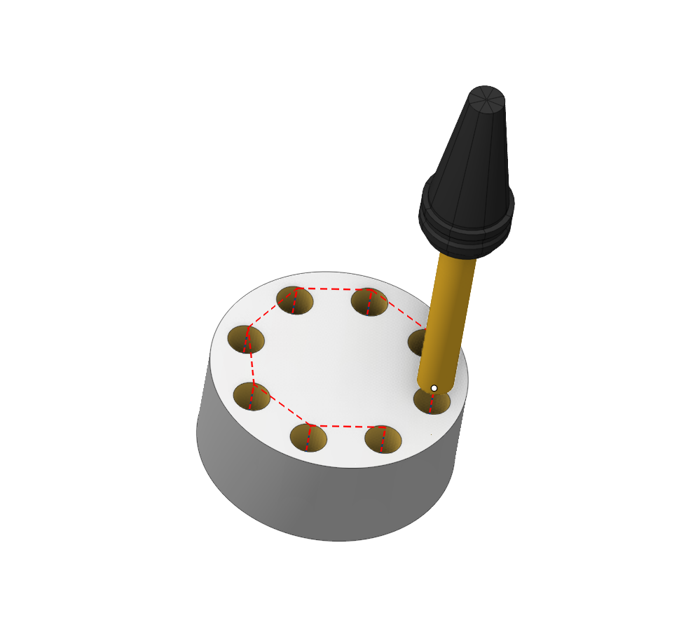

## 適用分野：

CAMシステムでは、様々なタイプの穴テンプレートを設定することが可能です。テンプレートに穴のジオメトリ構造を持たせる必要はありません 。

特定のルールを使用して、以下のテンプレートを定義することができます。

- 直線
- 円形
- 角度
- 同心円
- 平行四辺形

システムは5種類のパターンを使用します。`直線`、 `円形`、 `角度`、`同心円`、`平行四辺形`

- `直線`ページでは、ユーザーが直線状の穴パターンを作成できます。

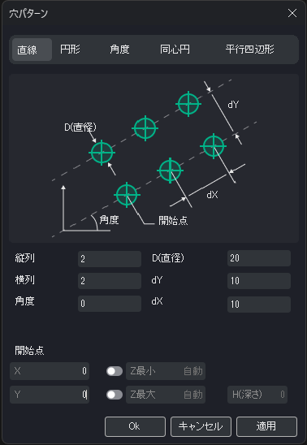 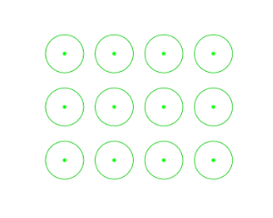

- `円形`ページでは、ユーザーが円形の穴パターンを作成できます。

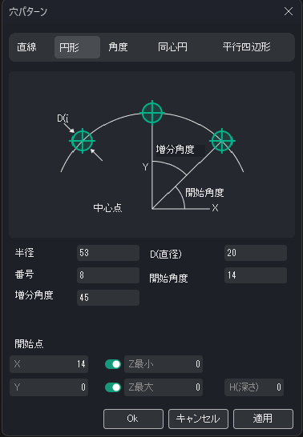 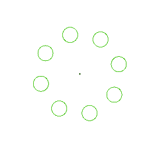

- `角度` ページでは、ユーザーが角度方向の穴パターンを作成できます。

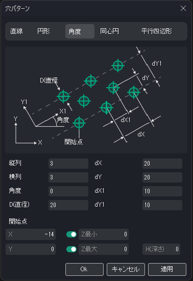 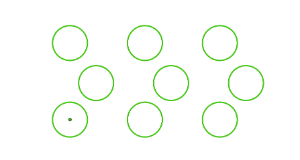

- `同心円` ページでは、ユーザーが同心円状の穴パターンを作成できます。

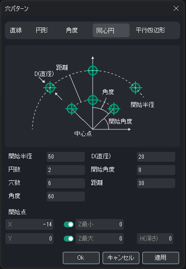 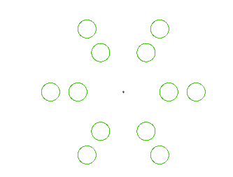

- `平行四辺形` ページでは、ユーザーが平行四辺形の穴パターンを作成できます。

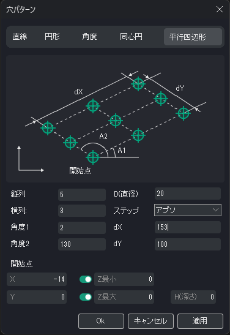 

穴パターンと穴高さの自動判定を組み合わせることで、軸方向のプランジング加工戦略による部品の荒加工を実行することができます。

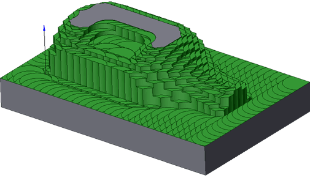
