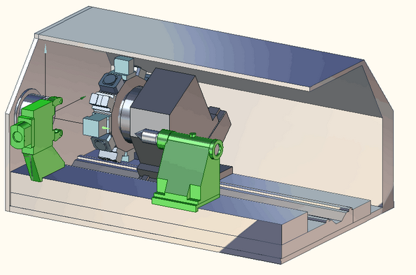
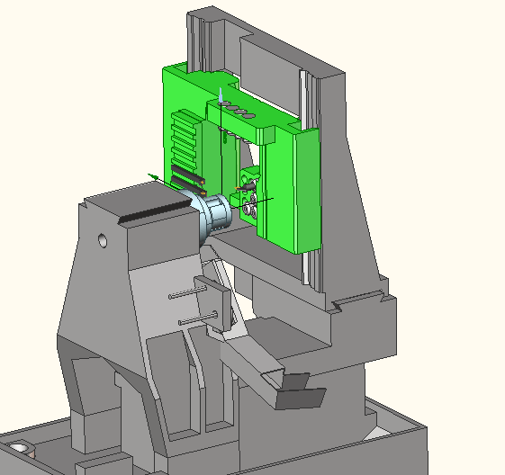

# 複合旋盤の種類

CAMシステムを使用することで、タレット旋盤加工センターやスイス型旋盤など、さまざまな旋盤向けのNCプログラムを生成することができます。

森精機NL2500の機械構成：

「スイス型」Po Ly Gim Mini-88Yの機械構成：

機械のキネマティックスを活用することで、ポペットヘッド、カラー板、刃物タレット、タレットから突出した工具など、すべての駆動部の干渉を視覚的に確認することができます。
