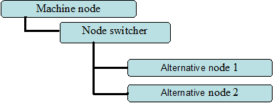
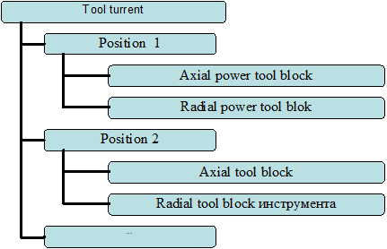
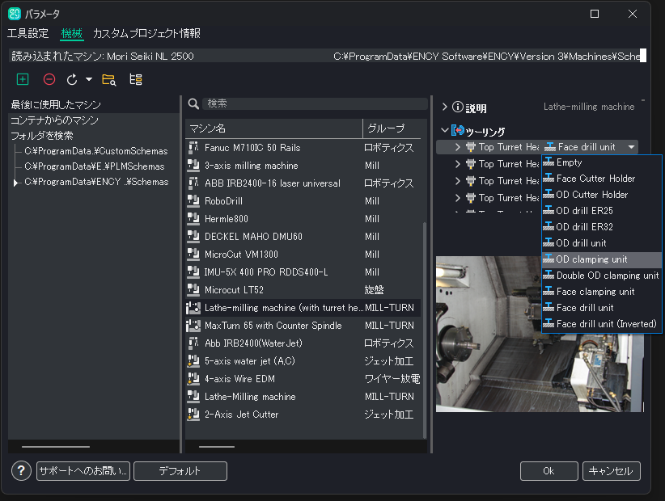

# 工具のセットアップ

多くの機械では、段取り替えによってキネマティクスが大きく変化する場合があります。そのため、キネマティクスを迅速かつ確実に変更できるよう、専用のノード切替機能（ノードスイッチャー）が用意されています。

機械のキネマティクススキームにおけるノードスイッチャー

ノードスイッチャーを使用することで、機械の親ノードに対して複数の代替ノードの中から１つを接続することができます。スキームにノードスイッチャーがある場合、ツリー上ではドロップダウンリストとして表示され、その中から代替ノードの１つを選択することができます。

例えば、タレット旋盤では、工具タレットの各工具取付位置に、複数種類のブロックの中から1つを取り付けることができます。ブロックを使用することで、軸方向または径方向の固定式工具（旋削工具）、および軸方向または径方向配置の回転工具を設定することができます。また、ブロックには異なるサイズや形式のタイプを使用することもできます。

工具タレットの記述例

ブロックの設定は、マシン選択ウィンドウでマシンをダブルクリックするか、`パラメータ`ボタンをクリックすることで行うことができます。

