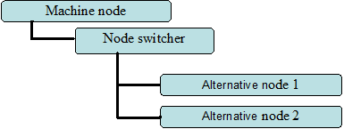
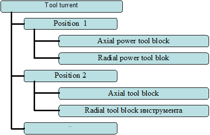
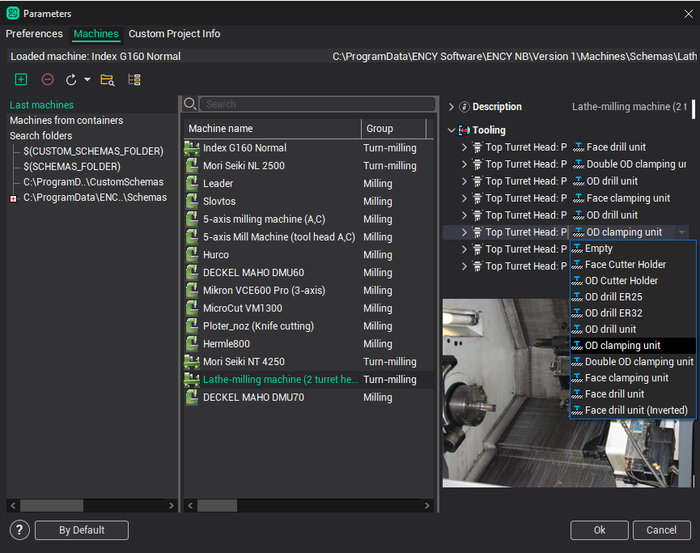

# Allestimento dell'attrezzatura

La cinematica di molte macchine può cambiare in modo sostanziale a seguito del riattrezzaggio. Per consentire una modifica rapida e controllata della cinematica della macchina è previsto un apposito nodo commutatore.

Nodo commutatore nello schema cinematico della macchina

Il nodo commutatore consente di collegare al nodo padre della macchina uno dei nodi alternativi. Se nello schema è presente un nodo commutatore, questo viene visualizzato nell'albero come un elenco a discesa dal quale è possibile scegliere uno dei nodi alternativi.

Ad esempio, in un centro di tornitura con torretta, in una posizione della torretta portautensili è possibile montare uno tra diversi tipi di blocchi. I blocchi consentono di montare un utensile fisso (da tornitura) assiale o radiale oppure un utensile motorizzato assiale o radiale. Inoltre, il blocco può avere diverse dimensioni.

Esempio di descrizione di una torretta portautensili

L'impostazione dei blocchi si effettua nella finestra di selezione della macchina facendo doppio clic sulla macchina oppure con il pulsante **Parameters** (parametri)

