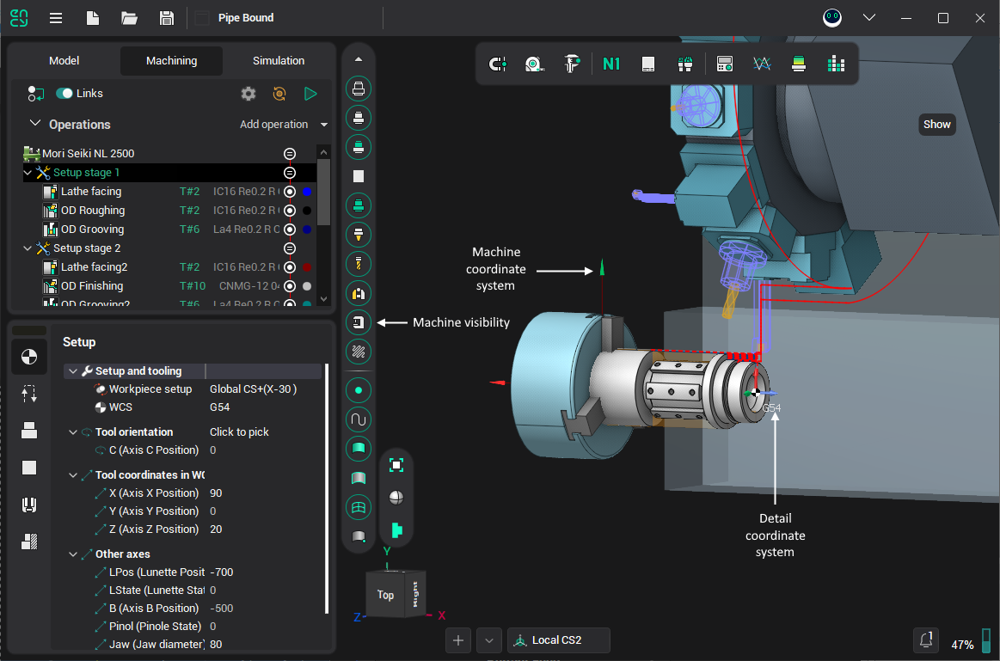
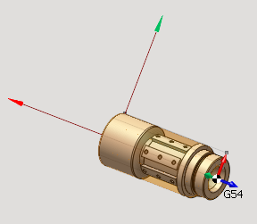
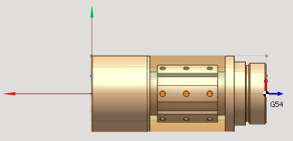
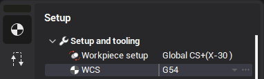

# Werkstück positionieren

Nach der Maschinenauswahl und der Einrichtung des Werkzeugrevolvers wird das Werkstück positioniert. Auf Dreh-Fräs-Maschinen werden in der Regel Rotationskörper bearbeitet. Das Werkstück kann aus einem CAD-System importiert oder durch eine im 2D-Geometriemodus erstellte Erzeugende definiert werden. Bei einem importierten Werkstück wird die Erzeugende aus dem 3D-Modell abgeleitet. Falls dabei Fehler auftreten, empfiehlt es sich, die Erzeugende als Kurve zu importieren und das Werkstück daraus zu erstellen.

Werkstückkoordinatensystem und Maschinenkoordinatensystem sind zu unterscheiden. Das Werkstückkoordinatensystem ist mit dem Werkstück verbunden und dreht sich beispielsweise bei einer Spindeldrehung mit. Bei eingeblendeter Maschine wird das Maschinenkoordinatensystem unten links im Grafikfenster angezeigt.

Bei ausgeblendeter Maschine zeigen die Hilfsachsen das Werkstückkoordinatensystem an.

Für die Drehbearbeitung muss die Werkstückachse mit der X-Achse ausgerichtet werden. Dies ist durch [Verschieben des Werkstücks](116.md) oder durch [Erstellen eines neuen lokalen Koordinatensystems](753.md) möglich. Üblicherweise wird der Koordinatenursprung auf die rechte Stirnfläche des Werkstücks gelegt.

Damit das erstellte Koordinatensystem verwendet wird, muss es in den Maschinenparametern oder in der aktiven Operation angegeben werden. Anschließend bringt das System Werkstücknullpunkt und Maschinennullpunkt zur Deckung.

Der Maschinennullpunkt liegt üblicherweise an der Spindelnase. Dadurch kann das Werkstück zunächst innerhalb der Maschine liegen. Für eine korrekte Darstellung muss die Lage des Werkstücknullpunkts im Maschinenkoordinatensystem festgelegt werden.
