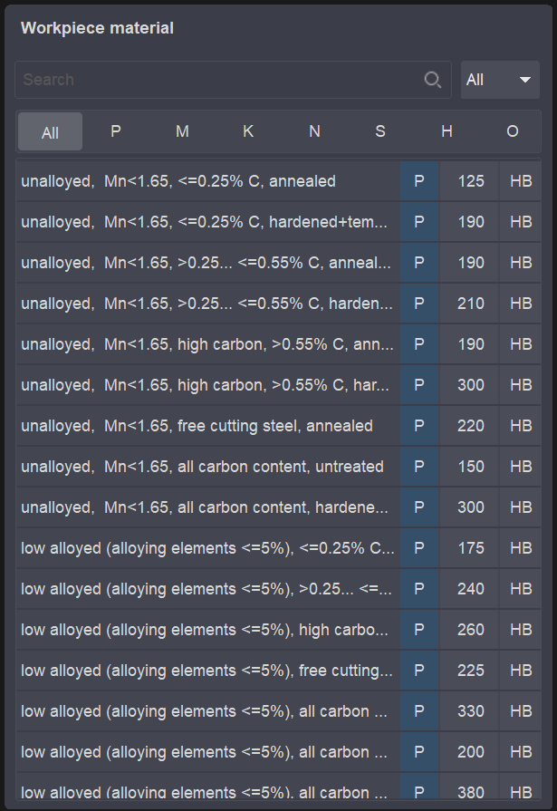
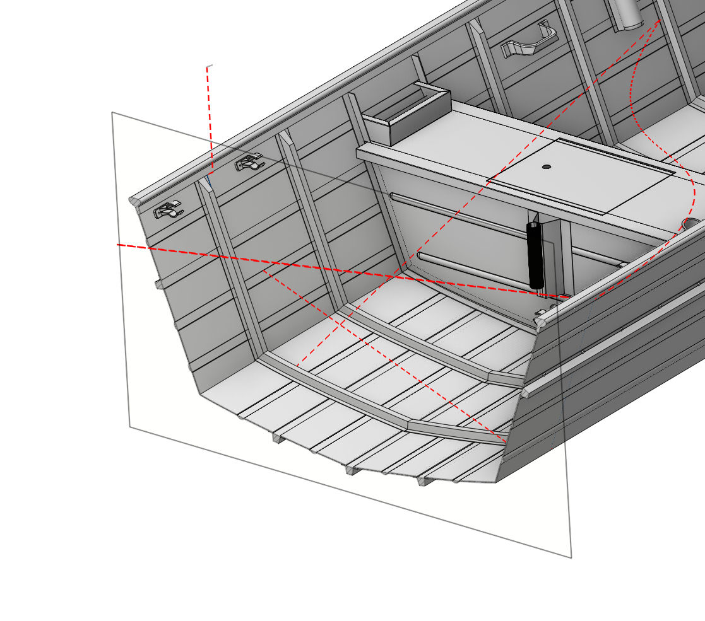
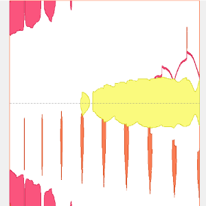
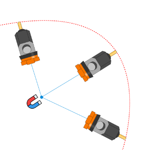
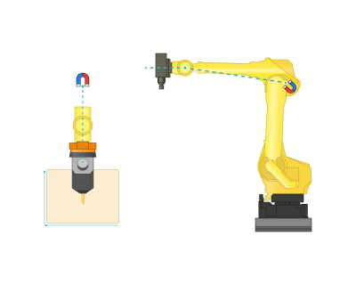
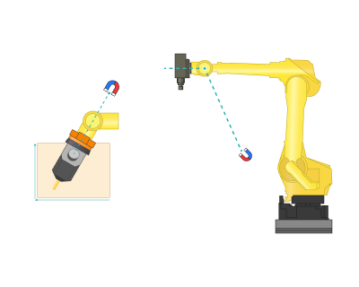
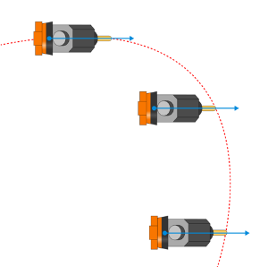
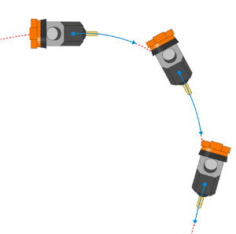
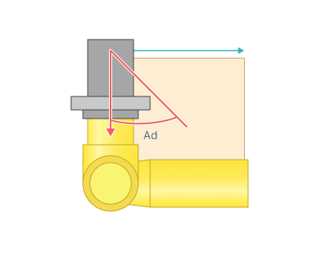

# Painel de configuração

## Área de aplicação:

A aba Setup é usada para configurar os parâmetros principais do projeto, como o posicionamento da peça no equipamento, o sistema de coordenadas da peça e outros.

### Propriedades da peça (disponíveis para o grupo Part). Veja mais

Clique aqui para expandir...

<strong>Número da peça.</strong> Identificador único atribuído no sistema CAM a uma peça usinada (bruto).

<strong>Material da peça.</strong> Material da peça usinada, selecionado em um catálogo de referência do sistema CAM. Cada entrada define a composição do material, sua condição (recozido, temperado etc.), o grupo de usinabilidade ISO (P, M, K, N, S, H, O) e a dureza (por exemplo, o valor HB). O sistema CAM usa essas propriedades para calcular os parâmetros de corte das operações de usinagem: velocidades, avanços e engajamento da ferramenta. [Detalhes](100128.md)

### Configuração e ferramentas.

Clique aqui para expandir...

<strong>Conector do bruto.</strong> Lista dos pontos de fixação do bruto na máquina (mesa fixa, mesa rotativa, placa esquerda etc.). A disposição dos sistemas de fixação e seu posicionamento são definidos na construção da cinemática da máquina.

<strong>Posicionamento do bruto.</strong> Determina a posição da peça no equipamento<strong>.</strong> [Detalhes](10066.md)

<strong>Posicionamento da base.</strong> O mesmo que o <strong>posicionamento do bruto</strong>, mas para <strong>robôs.</strong>

<strong>WCS.</strong> O sistema de coordenadas da peça (WCS, G54 – G59) define o "zero" do programa NC na peça. [Detalhes](10068.md)

<strong>Base.</strong> O mesmo que o <strong>WCS</strong>, mas para <strong>robôs.</strong>

<strong>Gerenciamento do ponto central da ferramenta.</strong> Modo de rotação contínua do sistema de coordenadas da peça junto com a própria peça. É usado na usinagem contínua em 5 eixos (desde que o comando CNC suporte esse modo).

<strong>CS local.</strong> Permite gerar uma trajetória em um sistema de coordenadas adicionalmente deslocado e girado em relação ao sistema de coordenadas da peça. Por exemplo, um programa para usinar uma cavidade inclinada em relação ao sistema de coordenadas da peça será muito mais simples se for gerado em um sistema de coordenadas local alinhado com a inclinação da cavidade. Esse método é usado na usinagem posicional em 5 eixos (3+2). Ao selecionar o valor 'Auto', a direção do eixo Z do sistema de coordenadas local é definida automaticamente ao longo do eixo de rotação da ferramenta, determinado pelos parâmetros do grupo Orientação da ferramenta. [Detalhes](726.md)

<strong>Conector da ferramenta.</strong> Determina o nó intercambiável de montagem da ferramenta.

### Orientação da ferramenta.

Determina a direção de orientação da ferramenta. [Detalhes](260.md)

Este grupo especifica os eixos rotativos principais.

### Limites da máquina.

Os limites reduzidos são usados no cálculo do <strong>percurso da ferramenta</strong> e dos <strong>mapas</strong>. Eles definem o intervalo em que as posições dos eixos são consideradas válidas, de modo que o movimento resultante fique restrito ao envelope especificado, e não a todo o curso da máquina.

Esses limites são tratados como limites da operação: descrevem o intervalo aceitável para a operação atual e são aplicados além dos limites globais da máquina importados da própria máquina.

### Coordenadas da ferramenta no WCS

Esta aba exibe os sistemas de coordenadas geométricos. Entre parênteses é mostrado o nome do eixo físico correspondente ao movimento ao longo de cada eixo.

### Eixos físicos lineares

Valores das coordenadas dos eixos lineares da máquina em relação ao ponto zero físico de cada eixo (o sensor de fim de curso do eixo). Aqui são exibidas todas as coordenadas físicas principais dos eixos que não participam das <strong>Coordenadas da ferramenta no WCS.</strong>

### Outros eixos

Este grupo especifica os eixos auxiliares, como os eixos relacionados ao movimento das castanhas da placa.

### Cinemática.

O grupo Cinemática define o comportamento cinemático do equipamento durante a execução do percurso da ferramenta: controle dos graus de liberdade excedentes, otimização dos movimentos e escolha da configuração dos eixos. É usado para definir como uma máquina multieixos ou um robô percorre fisicamente o percurso calculado.

Clique aqui para expandir...

<strong>Smart Motion.</strong> O Smart Motion permite gerar a trajetória do robô para pontos 5D e 6D sem exigir um <strong>mapa de eixos</strong> do robô. A trajetória resultante respeita os limites dos eixos e inclui a prevenção de <strong>singularidades</strong> e de <strong>colisões</strong>. Além disso, a trajetória pode ser ajustada com o mapa de eixos do robô.

 

<strong>Mapa de eixos.</strong> O <strong>mapa de eixos</strong> permite definir leis de controle manuais e ajustar as leis automáticas para os graus de liberdade excedentes de um robô (o 6º eixo, os eixos de trilhos, os eixos da mesa giratória). O recurso é acessado pelo botão de reticências ao lado do parâmetro Axes map. Para otimizar a usinagem, é possível alternar entre os diferentes eixos disponíveis no equipamento.

O mapeamento é aplicável a robôs ([Detalhes](10266.md)) e a máquinas de 5 eixos ([Detalhes](10147.md)).

<strong>Flips.</strong> Alternância da configuração das juntas. Os <strong>botões J1, J3 e J5</strong> alternam a configuração (postura) da junta correspondente, escolhendo uma solução alternativa da cinemática inversa. Eles permitem obter outra disposição dos eixos mantendo a posição e a orientação da ferramenta, por exemplo, para evitar um limite de curso ou uma colisão.

### Controle do 6º eixo

Para posicionar uma ferramenta axial (fresa, feixe, jato), são necessários cinco graus de liberdade. Um robô industrial padrão tem seis eixos. Se a ferramenta não estiver alinhada com o eixo de rotação da última junta do robô, existem infinitas possibilidades de posicionar o robô exatamente em um ponto, girando a ferramenta em torno de seu próprio eixo. Isso oferece flexibilidade adicional para alcançar áreas de difícil acesso, ajuda a contornar várias singularidades cinemáticas e evita colisões mecânicas entre os componentes do equipamento. [Detalhes](10263.md)

Clique aqui para expandir...

<strong>Direcionar para o ponto.</strong>

Neste modo, especifica-se um ponto 3D que atrai para a menor distância possível o ponto de interseção do 5º e do 6º eixos durante a usinagem.

<strong>Ponto.</strong>

<strong>Ponto da base do robô.</strong> Neste modo, o ponto é posicionado no ponto de origem/base do robô.

<strong>Ponto do cotovelo do robô.</strong> Neste modo, o ponto é posicionado no ponto do cotovelo do robô.

<strong>Personalizado.</strong> Neste modo, a posição do ponto é definida pelo usuário.

<strong>Vetor fixo.</strong>

Neste modo, define-se a direção desejada do flange do robô (6º eixo) no sistema de coordenadas da base do robô.

<strong>Vetor.</strong> Vetor do 6º eixo do robô.

.png)

<strong>Percurso da ferramenta</strong>

Neste modo, um dos eixos do TCP é alinhado com a direção do percurso da ferramenta.

<strong>Desvio angular.</strong> Define um ângulo adicional do 6º eixo em torno da ferramenta.

<strong>Aproximação tangente.</strong>

<strong>Direção de avanço fixa.</strong> Fixa o movimento da ferramenta no ângulo selecionado no mapa (Lean angle, Lead angle) em relação ao sistema de coordenadas global selecionado.

).png) ).png)

