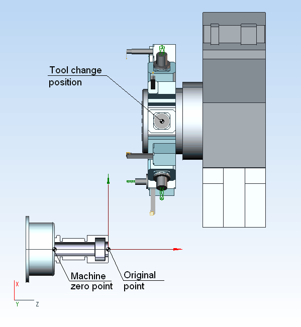

# 工具交換の位置

工具交換位置の座標は、機械の原点（0点）を基準に算出されます。CAMシステムでは通常、旋盤のZ方向の機械原点は主軸ノーズ位置に設定されています。そのため、工具交換位置のZ座標は、以下の式で計算できます。

<strong>Z工具交換位置 = パーツの長さ + 最長軸方向工具の突出量 + 安全距離</strong>

工具交換の位置によって、タレットブロックの中心から主軸の軸線までの距離が決まります。

そのため、X座標は以下のようになります。

<strong>X 工具交換位置 = ワーク半径 + 最長</strong> <strong>径方向工具の突出量 + タレット半径 + 安全距離</strong>

機械のスキームによっては、タレットヘッドの取り付け位置が X 方向に一定距離ずれている場合があります。この場合、工具交換位置は試行によって決定します。

軸方向または径方向の逃げ動作を行う際には、工具交換位置が NC プログラムに影響することに注意する必要があります。

例えば、工具交換位置に対する径方向の逃げ動作は2段階で行われます。

第一段階では、タレットヘッドの中心が「X 工具交換位置」に来るように、工具先端を X 方向に移動させます。そのため、NCプログラムには以下の座標が含まれることになります。

<strong>X=X 工具交換位置 - 軸方向工具の突き出し量 - タレットヘッドの半径</strong>

次の段階は、 <strong>GOHOME</strong> (G28)コマンドによって実行されます。つまり、このステップでは座標値は出力されません。
