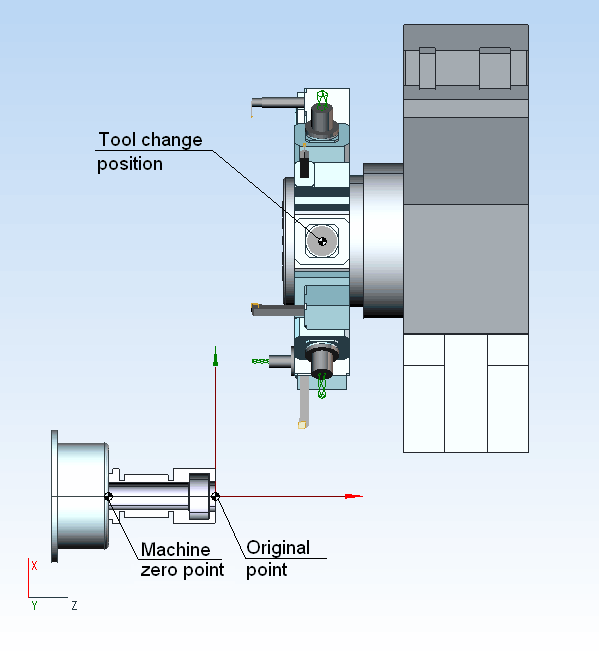

# 工具交換の位置

工具交換点の座標は、機械原点を基準にします。CAMシステムでは、通常、旋盤のZ方向原点は主軸端面にあります。そのため、工具交換点のZ座標は次の式で計算できます。

<strong>Z工具交換位置 = パーツの長さ + 最も長い軸方向工具の突き出し量 + 安全距離</strong>

工具交換位置は、タレットブロックの中心から主軸の軸線までの距離を定めます。したがって、次の式になります。

<strong>X工具交換位置 = ワーク半径 + 最も長い径方向工具の突き出し量 + タレット半径 + 安全距離</strong>

マシンスキーマによっては、タレットヘッドの取付点がX方向に一定距離ずれています。この場合、工具交換点は実際に確認しながら決定します。

軸方向または径方向の退避動作を生成する際、工具交換位置はNCプログラムに影響します。例えば工具交換点への径方向退避は2段階で行います。まず、タレットヘッドの中心がX工具交換位置になるように、工具先端をX方向に移動します。そのため、次の座標がNCプログラムに含まれます。

<strong>X=X 工具交換位置 - 軸方向工具の突き出し量 - タレットヘッドの半径</strong>

次の段階は、 <strong>GOHOME</strong> (G28)コマンドによって実行されます。つまり、このステップでは座標値は出力されません。
