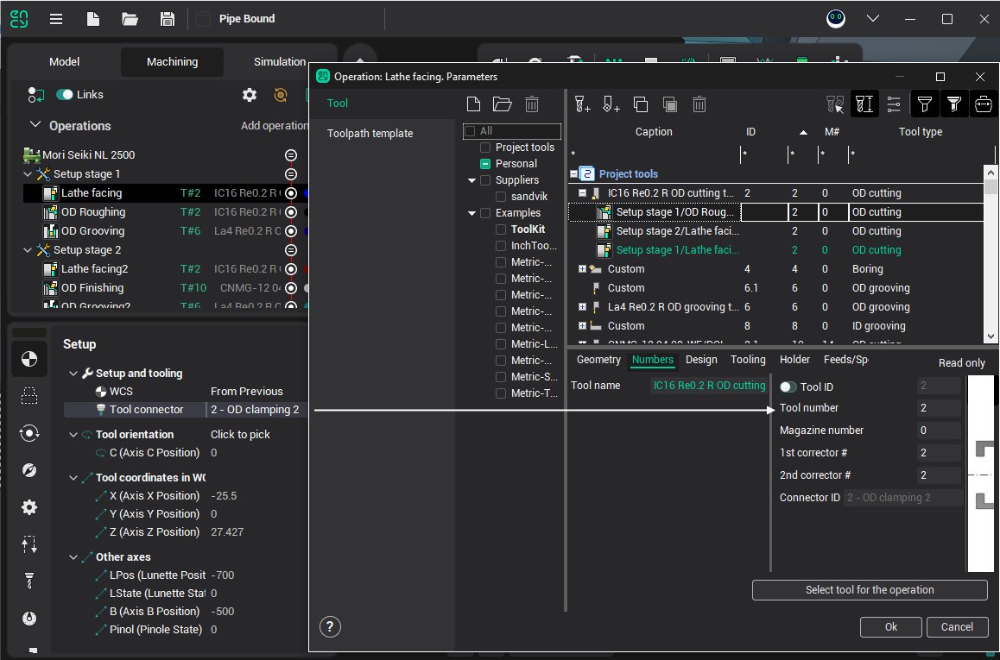
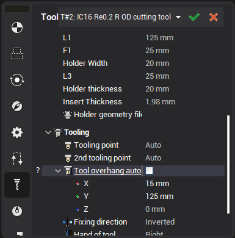

# 工具の位置決め

パーツの位置と工具交換点を設定した後、新しい[オペレーション](10174.md)を作成できます。主要な設定の1つは、オペレーションで使用する工具です。タレット機では、工具コネクターの位置（タレット位置番号）が、NCプログラムに出力する工具番号を決めます。工具コネクターを変更すると工具番号も変わりますが、工具番号を変更しても工具コネクター番号は変わりません。

工具の突き出し量は、工具交換点へ移動するNCプログラムに影響します。タレット座標系での工具の定義点にも影響します。突き出し量は、**加工**モードの**工具**ウィンドウで設定します。

