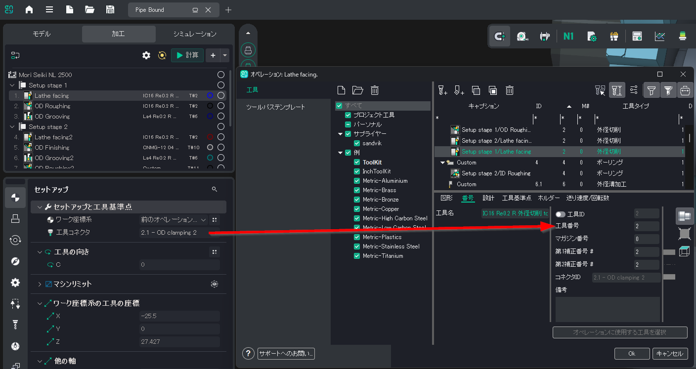
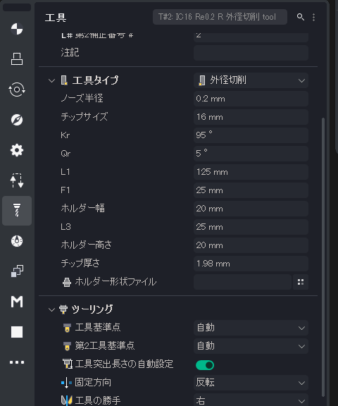

# 工具の位置決め

パーツの位置を設定し、工具交換位置を定義した後、新しい[オペレーション](10174.md)を作成できます。オペレーションの主要な特徴の１つが、オペレーションで使用する工具です。

タレット加工機の工具コネクタ位置（タレット位置番号）については、NCプログラム出力用の工具番号を定義します。そのため、工具コネクタを変更すると、工具番号も変更されます。ただし、工具番号を変更しても、工具コネクタ番号は変更されません。

工具の突き出し量は、工具を工具交換位置へ移動させる際のNCプログラムに影響します。工具の突き出し量の値は、タレット座標系における工具定義点に影響します。

工具の突き出し量は、 `加工`モードの`工具`ウィンドウで設定します。

