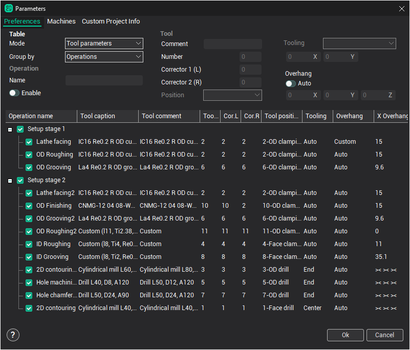

# Testes obrigatórios antes da geração final

O controle final dos parâmetros é executado na janela de resumo das operações. Para abrir a janela, selecione a operação raiz (a máquina) e clique no botão **Parameters**.

A janela permite editar parâmetros do mesmo tipo de várias operações ao mesmo tempo. Para isso, selecione as operações necessárias mantendo pressionada a tecla [Shift] ou [Ctrl] e, em seguida, insira os valores necessários nos campos de entrada localizados na parte direita da janela. A janela tem dois modos: o modo de edição de ferramentas e o modo de edição de condições de corte.

1. Verifique se os números das ferramentas instaladas estão corretos. O sistema não verifica se, em operações diferentes, ferramentas diferentes foram instaladas com os mesmos números.
2. É obrigatório verificar o ponto de ajuste da ferramenta em todas as operações. Se ele não estiver correto, a simulação funciona corretamente, mas o programa NC é gerado com um erro grave, o que pode causar a quebra da ferramenta ou até mesmo da máquina.
3. Alterne para o modo de controle das condições de corte e verifique o sentido de rotação do fuso, a refrigeração e a correção dos valores de avanço.
4. Após qualquer alteração de parâmetros e recálculo da trajetória, simule novamente o processo de usinagem e certifique-se de que não há pontos de exclamação.
