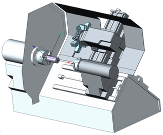
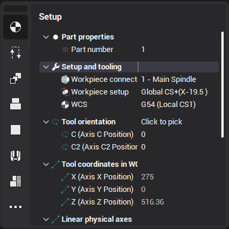
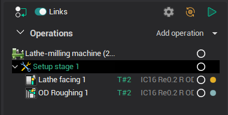
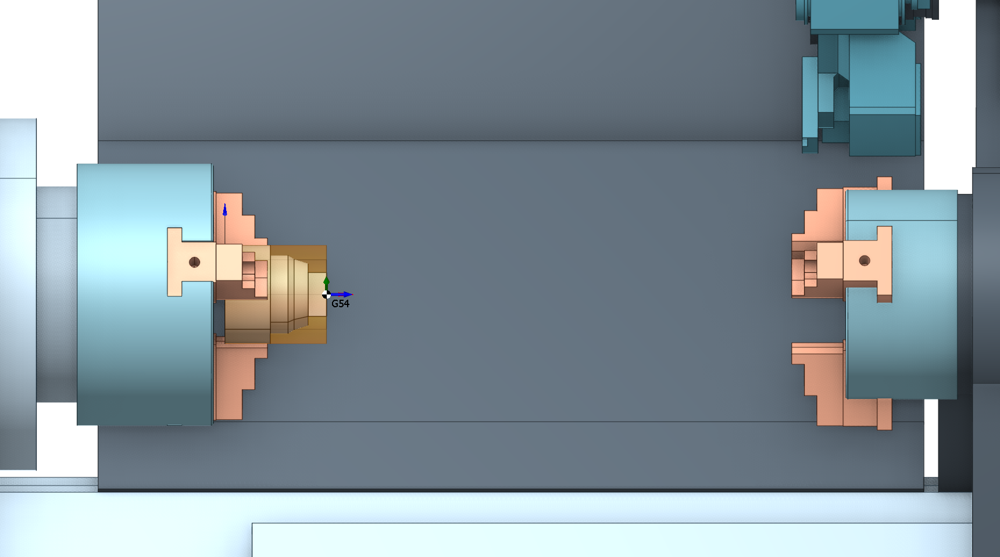
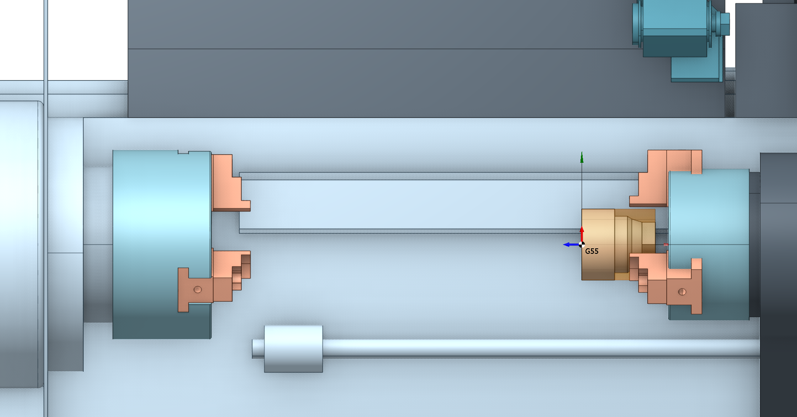
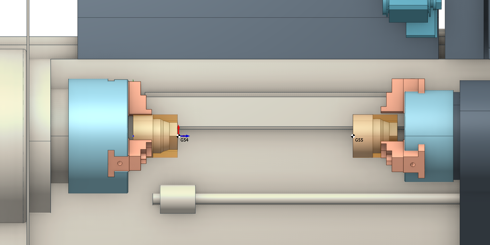
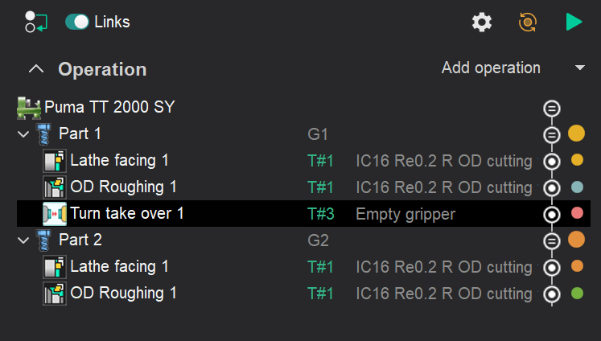
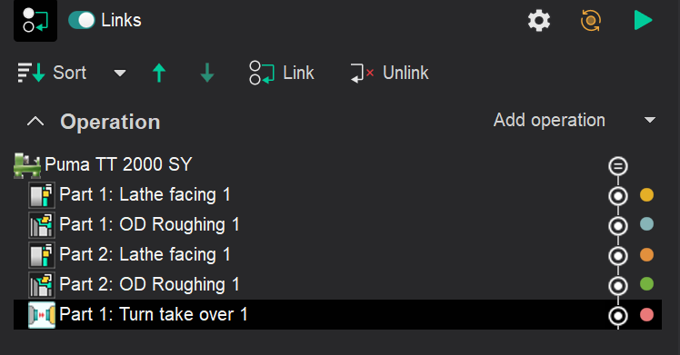

# カウンタースピンドル加工

## 適用分野：

CAMシステムでは、旋盤加工および複合旋盤加工の両方に対応したカウンタースピンドル加工用 NCプログラムを作成できます。

## サブスピンドルを備えた機械での加工の特徴

### 主なプロジェクト設定には、通常、以下が含まれます。

カウンタースピンドル加工の工程を作成する前に知っておくべきことは以下の通りです。

1. 加工を開始する主軸
2. ワーク座標系（ワークを設置する位置）。この座標系のプロパティで、 機械座標系（例：G54）として指定します。ワーク座標系は、ワークの固定されていない側の端面に紐づけることを推奨します。

最初に、ワークの初期位置を定義する <strong>セットアップステージ</strong> または <strong>パーツ</strong> オペレーションを作成します。ワーク座標系とワークを固定する主軸は、 セットアップタブの <strong>ワークコネクタ</strong>, ワークセットアップ、**WCS**フィールドでそれぞれ指定します。

ワーク位置を定義した後、露出している部品要素を加工する必要があります。

<em><strong>注記：</strong> 後続のオペレーションで使用する主軸を取り違えないように、**Current workpiece holder**フィールドに`Frоm the previous operation`を指定してください。</em>

### 複合旋盤加工プロジェクトのワークフロー

ワークを1つのスピンドルから別のスピンドルに再固定するには、 <strong>ステージ</strong>または <strong>パーツ</strong> オペレーションを作成します。マルチパートプロジェクトの詳細については、 <strong>マルチパーツプロジェクト</strong>を参照してください。[詳細を見る](1025.md)

複合旋盤加工プロジェクトでは、一般的に次のようなシナリオがあります。

- <strong>セットアップ1 - セットアップ2</strong> ワークをセットアップ 1 からセットアップ 2 に移動し、フライス加工や穴あけなどの追加加工を行います。  
- <strong>パーツ1 - パーツ2</strong> 同じ機械で2つの異なるパーツ（パーツ1とパーツ2）を加工します。場合によっては異なるオペレーションや工具を使用して、複雑な部品や隣接する部品を作成することもできます。

<em></em>

再固定後、残りのサーフェスを加工するためのオペレーションを作成します。オペレーションは、旋盤加工または複合旋盤加工のいずれかになります。これらのシナリオは、複合旋盤加工機の柔軟性と多機能性を示しており、同じ機械でさまざまな加工を行うことができます。

### パーツ移動

主軸から対向主軸へパーツを移動させる動作をシミュレーションするには、<strong>掴み換え</strong>オペレーションを使用します。[詳細を見る](10406.md)

プロジェクトに複数のパーツが含まれている場合は、<strong>順序とリンク</strong>を使用して、このオペレーションを製造プロセスの最後に移動することを 忘れないでください。

<strong>掴み換え</strong> オペレーションでは、新しいワークを固定するために、主軸からパーツ（半製品）を排出する動作をシミュレーションすることが想定されています。その後、パーツを受け渡す工程が続きます。
