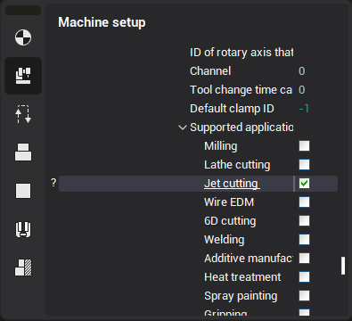

# 切断機による加工

切断機 は、さまざまな種類の板材から平面形状のパーツを切り出すための装置です。これらの装置は、切断方法によって2つのグループに分類されます。最も広く使用されている機械では、次のような方法が採用されています。

- プラズマ切断 ガスによって吹き付ける圧縮電気アークを使用します。アークを吹くと、ガスが加熱され、正および負に荷電した粒子に分解（イオン化）されます。荷電した粒子は、最大 15,000 ℃ の高温となるプラズマ流に変換されます。
- レーザー切断 あらゆる板材から輪郭に沿ってパターンを切断できる、最も先進的な技術のひとつです。この技術の中心には、焦点を合わせたレーザービームの作用があります。この装置は、さまざまな種類の板材の切断に適しています。焦点を合わせたレーザービームの主な利点は、滑らかな切断面と高精度な切断線です。
- 酸素切断 発火温度まで加熱された金属が、工業用純酸素中で燃焼する性質を利用した金属の切断方法です。酸素切断では、1200～1300℃に加熱された金属に酸素流を吹付け、金属を燃焼させながら切断します。
- ウォータージェット切断 高圧（400 MPa）水流にザクロ砂（ガーネットサンド）を混合して切断する方法です。高圧水流の大きな力により切断、より正確には固体構造を分子レベルで破壊します。 この方法では、あらゆる種類の金属や合金、難切断材（ステンレス鋼、耐熱鋼、高強度合金、チタン合金など）だけでなく、花崗岩、セラミックス、耐火ガラス、防弾ガラス、ゴム、紙、フェルト、複合材料なども高品質に切断できます。

デフォルトで無効になっているマシンで切断オペレーションを使用できるようにするには、下図に示すように、マシンパラメータの工具プロパティセクションにある「対応アプリケーション - ジェット加工」のチェックボックスを有効にします。

