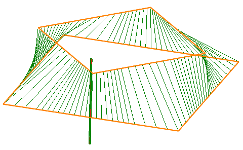
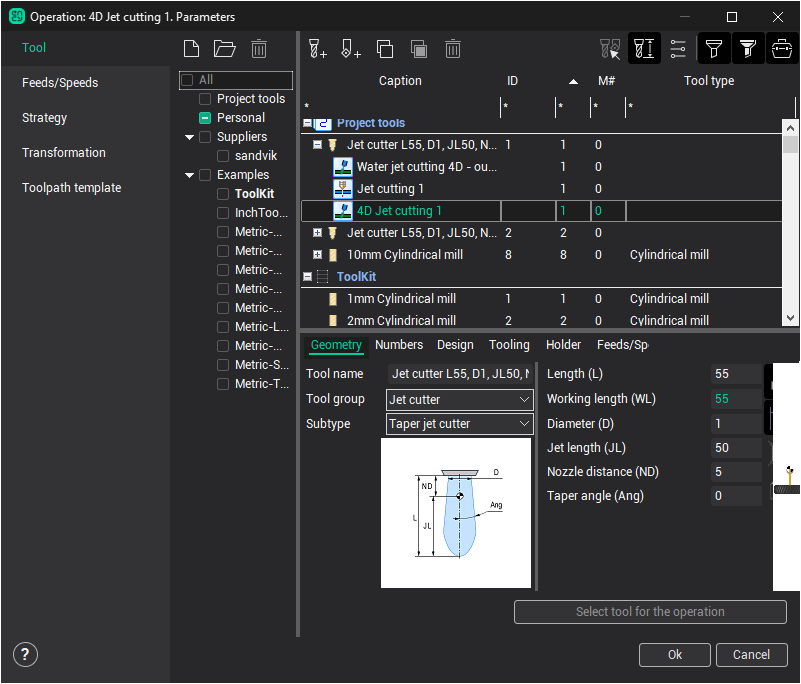

# Taglio a getto 4D

L'operazione di taglio 4D consente di creare non solo percorsi utensile puramente 2D, con l'asse utensile orientato verticalmente, ma anche percorsi utensile 4D più complessi, in cui l'asse utensile è inclinato secondo l'angolo della parete della geometria di lavoro. Al tempo stesso, la punta dell'utensile si trova sempre nello stesso piano, per cui la coordinata Z rimane costante all'interno di uno stesso contorno. Di conseguenza, la geometria da lavorare può essere definita come una curva piana (caso 2D) oppure come due curve (superiore e inferiore, caso 4D), insieme alla linea di sincronizzazione. Queste linee collegano i contorni e determinano l'angolo dell'utensile in ciascuna posizione, come mostrato di seguito. La geometria di lavoro viene specificata nella [finestra Job assignment](10229.md).

L'utensile predefinito di questa operazione è un utensile da taglio a getto (Jet cutter) con le proprietà elencate di seguito.

- Jet length: la lunghezza del getto o del fascio che asporta il materiale in modalità di simulazione.
- Diameter: il diametro del getto o del fascio nel punto di uscita dall'ugello.
- Taper angle: l'angolo di conicità, se presente.
- Nozzle distance: la distanza dal bordo inferiore dell'ugello al punto di contatto dell'utensile, cioè il punto che si muove sul livello superiore del contorno di lavoro definito nell'assegnazione del lavoro. Per impostazione predefinita questo punto coincide con il punto di regolazione dell'utensile, che viene emesso nel codice NC.

La [finestra di definizione delle condizioni di taglio](10237.md) consente di specificare singolarmente i parametri di ciascuna passata di offset (se è necessaria più di una passata).

- Velocità di avanzamento
- Codice della condizione di taglio
- Distanza di offset per il livello esatto
- Codice di offset o numero del correttore del raggio.

Nella [scheda Strategy della finestra dei parametri](10238.md) è possibile impostare parametri come l'ottimizzazione dell'ordine e della direzione, le opzioni di lavorazione a più passate, i ponticelli, ecc.
