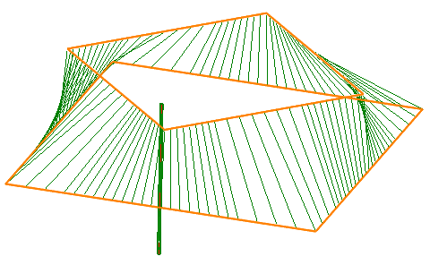
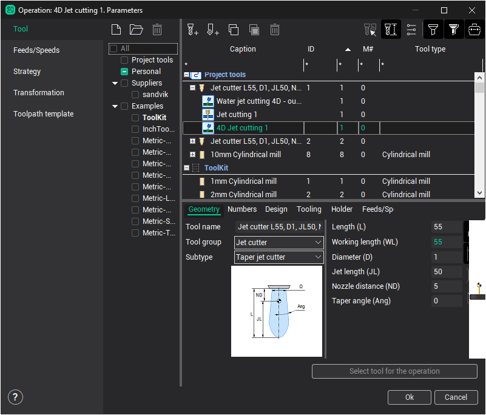

# 4D ジェット加工

4Dジェット加工オペレーションでは、工具軸を垂直に保つ単純な2Dツールパスだけでなく、ワーク形状の壁面角度に応じて工具軸を傾ける、より複雑な4Dツールパスも作成できます。同時に、工具先端は常に同一平面上に配置されるため、同一輪郭内では Z 座標は一定に保たれます。そのため、加工対象の形状は、平面曲線（2Dの場合）または上下2本の曲線（4Dの場合）として定義できます。

また、同期線も指定することが可能です。これらの輪郭同士を結び、下図に示すように、各位置における工具の角度を決定します。ワーク形状は、[ジョブ割り当てウィンドウ](10229.md)で指定します。

このオペレーションで使用される工具は、デフォルトではジェットカッターで、下記の特性を持っています。

- ジェット長 - シミュレーションで素材を除去する際に使用す、ジェットまたはビームの長さを示します。
- 直径 - ノズル出口におけるジェットまたはビームの直径です。
- テーパー角度 — 工具にテーパーがある場合、その角度を指定します。
- ノズル距離 - ノズルの下端から工具の接触点までの距離を示します。この接触点は、ジョブ割り当てで定義されたワーク輪郭の上部を移動する点です。デフォルトでは、この点はNCコードに出力される工具の調整点と一致します。

[切断条件定義ウィンドウ](10237.md)では、各オフセットパスのパラメータを個別に指定できます(複数のパスが必要な場合)。

- 送り速度
- 切断条件コード
- 指定深さでのオフセット距離
- オフセットコード、または径補正番号

[パラメータウィンドウのストラテジタブ](10238.md)では、加工順序および加工方向の最適化、マルチパス加工の設定、ブリッジなどの各種パラメータを指定できます。
