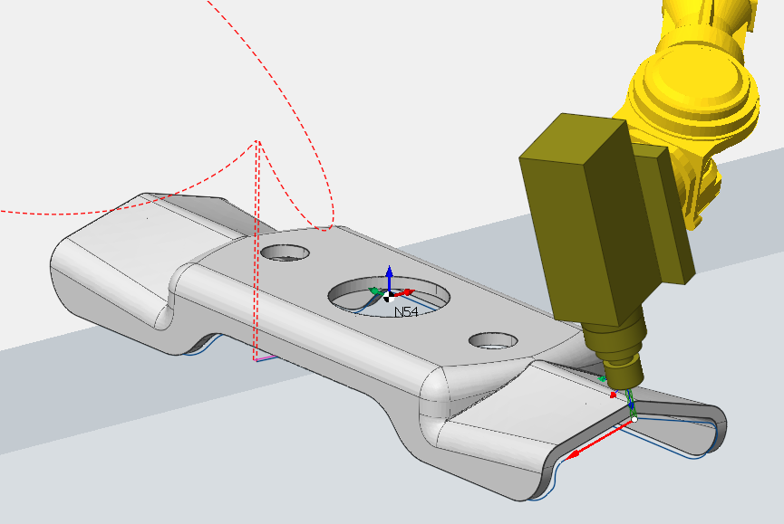
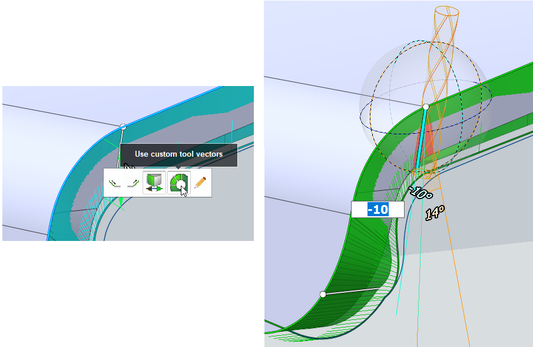
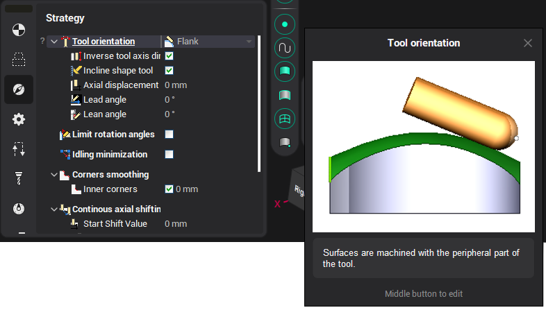
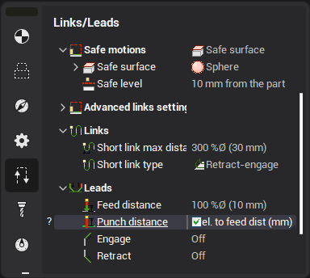

# 5D-Strahlschneiden

Die Operation **Jet cutting 5D** dient zum Schneiden entlang räumlich geformter Oberflächen. Sie basiert auf [5D-Konturieren](10129.md), enthält jedoch nicht die für diesen Anwendungsfall unnötige Mehrfachdurchgangsbearbeitung.

Die [Definition der Bearbeitungsprofile](10132.md) und weitere hier nicht erläuterte Parameter sind bei [5D-Konturieren](10129.md) beschrieben.

Die Operation erfordert mindestens fünf Freiheitsgrade. Die aktive Maschine muss daher mindestens drei Linearachsen und zwei bis drei Drehachsen besitzen. Häufig werden Industrieroboter zum Schneiden eingesetzt. Unterstützt das Maschinenschema nicht alle erforderlichen Freiheitsgrade, wird keine korrekte Werkzeugbahn erzeugt.

Legen Sie in der Auftragszuweisung die Konturen fest, entlang derer geschnitten werden soll:

- Modellkanten: Die Werkzeugausrichtung wird aus den an die Kante angrenzenden Flächen berechnet.
- Einfache, in einem CAD-System gezeichnete Kurven.
- Direkt im CAM-System gezeichnete [räumliche Splinekurven](10157.md).

In den letzten beiden Fällen werden die Werkzeugwinkel anhand der nächstgelegenen Bauteilflächen berechnet.

Nach der Konturdefinition können Sie in den [Modus zur benutzerdefinierten Vektorbearbeitung](10134.md) wechseln und die Werkzeugwinkel an den einzelnen Kurvenpunkten direkt im Grafikfenster anpassen.

Wählen Sie in den Parametern außerdem die passende Regel für die Werkzeugausrichtung. Die Operation bietet verschiedene Strategien. Über die Schaltfläche für den erweiterten Hinweis  neben dem jeweiligen Parameter erhalten Sie zusätzliche Informationen.

Auf der Registerkarte **Links/Leads** kann außerdem ein Einstechabstand eingestellt werden. Damit wird das Werkzeug auf den für das Einstechen erforderlichen Abstand zurückgezogen.

Zwei Eingabearten stehen zur Verfügung:

1. **mm:** Der eingegebene Wert wird in Millimetern angegeben.
2. **rel. to feed dist:** Der eingegebene Wert wird relativ zum Vorschubabstand (**Feed distance**) ausgewertet.

Dieser Parameter steht auch bei Plasmaoperationen zur Verfügung.
