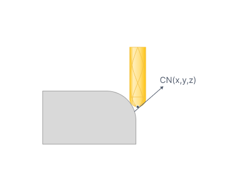
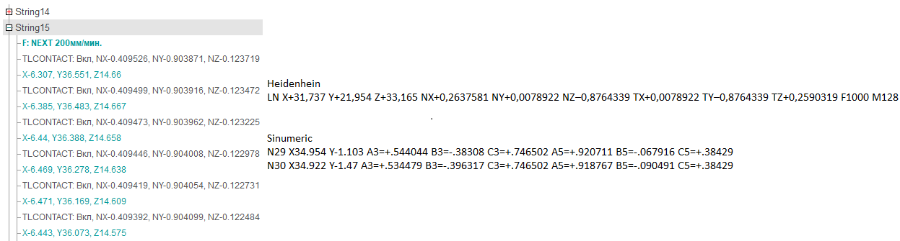

# 3D 工具補正

## 適用分野:

サーフェス仕上げ加工では、出力される G コードに、工具接触点におけるサーフェス法線ベクトルを含めることができます。これにより、<strong>3D工具補正</strong>を実現できます。3D工具補正とは、ツールパス上の各点において、ワーク表面に対する工具の位置を制御しながらオフセットする機能です。

Gコードにサーフェス法線ベクトルを出力するには、 <strong>マシンセットアップ</strong>パネルのマシンスキーマ設定で<strong>工具接触点のサーフェス法線ベクトルを設定</strong>オプションを有効にします。（[詳細を見る](1021.md)）この設定を有効にすると、CLData の各工具経路点に TLCONTACT (NX, NY, NZ) コマンドが生成されます。

- 接触点の法線ベクトルをそのまま G コードに出力する
- 指定された補正量に基づき、各工具経路点を法線ベクトル方向へ手動でオフセットして出力する

