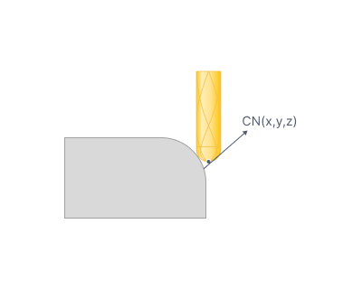
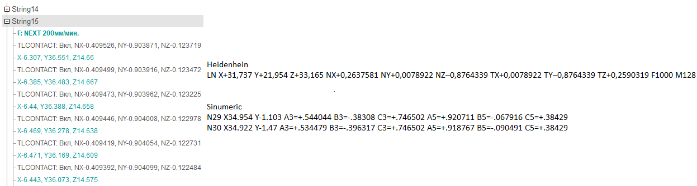

# Compensação 3D da ferramenta

## Área de aplicação:

Nas operações de acabamento de superfícies, a saída G-code pode incluir o vetor normal da superfície no ponto de contato da ferramenta. Isso permite implementar a **compensação 3D da ferramenta**: um deslocamento controlado da ferramenta de corte em relação à superfície do bruto em cada ponto do percurso da ferramenta.

Para incluir os dados do vetor normal da superfície na saída G-code, ative a opção **Set tool contact surface normal vectors** (no **Machine setup panel** [Detalhes](1021.md)) nas configurações do esquema da máquina. Isso gera o comando TLCONTACT (NX, NY, NZ) no CLData para cada ponto do percurso da ferramenta. O pós-processador deve então:

- emitir a normal de contato diretamente no bloco G-code; ou
- deslocar manualmente cada ponto do percurso ao longo desse vetor pelo valor de correção especificado, conforme o suporte à compensação 3D do sistema CNC de destino.

