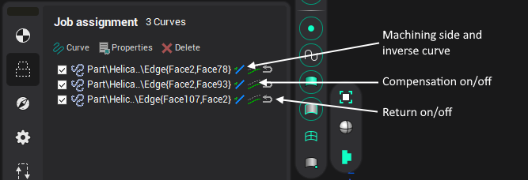
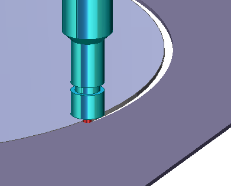
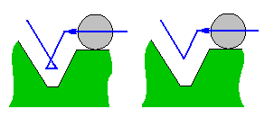
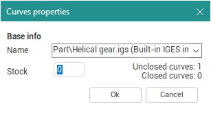
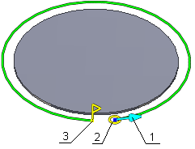

# Definição da tarefa de corte a jato

A operação de [corte a jato](326.md) permite criar um percurso da ferramenta a partir de uma curva selecionada. Em um nível bem básico, com essa operação uma curva pode ser transformada em um programa NC. As curvas a serem usadas para criar o percurso da ferramenta devem ser adicionadas à lista de curvas da [definição da tarefa](301.md) da operação. Para definir um círculo, um elemento do modelo pode ser adicionado como um ponto com sobremetal. Para adicionar o ponto (centro do círculo) como elemento do modelo, adicione-o na caixa de diálogo Job assignment e atribua a ele um sobremetal adicional igual ao raio do círculo.

Se várias curvas forem selecionadas para usinagem e o modo de minimização dos movimentos em vazio estiver desmarcado na página **Strategy** da janela **Operation parameters**, a ordem de usinagem corresponderá à ordem na lista. Para alterar a sequência dos objetos geométricos na lista, arraste-os com o mouse.

A direção de usinagem de uma curva selecionada pode ser invertida clicando na coluna **Inversion**.

A operação de corte a jato pressupõe um jato de plasma, um jato de fluido ou um feixe de laser como ferramenta de corte. O percurso da ferramenta pode passar à esquerda da curva, à direita da curva ou ao longo da curva.

Se o percurso da ferramenta passar **Along the curve** (ao longo da curva), o programa NC representará a própria curva. O comando de compensação do raio da ferramenta será gerado no programa se a opção correspondente estiver marcada. Essa é a maneira mais simples de converter uma curva qualquer definida no CAD em código CNC.

Para o percurso da ferramenta que passa **At the left** ou **At the right** da curva (à esquerda ou à direita), a curva equidistante correspondente é gerada no programa NC. O valor do deslocamento é especificado no painel **Curves properties**. Se a compensação estiver desativada, o valor do deslocamento será a soma aritmética do raio da ferramenta usada e do valor do sobremetal da operação. Se o sobremetal da operação for menor que zero, o valor do deslocamento será reduzido pelo seu valor.

A ativação de **Compensation** faz com que o percurso da ferramenta gerado contenha os comandos `G41`, `G42`, `G40` com os números de corretor correspondentes. Uma sequência típica de ações para gerar um percurso da ferramenta com compensação ativada é: marque a caixa **Compensation** no painel **Curves properties**, depois selecione o lado da usinagem (esquerda ou direita) na mesma caixa de diálogo, em seguida ative **Radius compensation** da ferramenta na guia **Tool** do painel de parâmetros da operação e defina o valor de compensação adequado.

O percurso da ferramenta da operação de corte a jato é a trajetória do eixo central do cortador.

Se for necessário que a ferramenta retorne ao longo de um contorno já usinado, clique na coluna **With return**: a ferramenta percorrerá o contorno selecionado e depois voltará ao longo dele até o ponto original. A figura acima mostra um exemplo de usinagem ao longo de um contorno com retorno. A transição de um contorno para outro é realizada contornando o bruto no mesmo nível dos contornos de trabalho.

Os comandos CNC modernos permitem que o programador use as coordenadas reais da peça, enquanto o operador insere o raio da ferramenta no comando. Isso permite ao operador, por exemplo, ajustar o sobremetal para operações de desbaste/acabamento. Às vezes, isso pode levar a situações em que o percurso equidistante calculado pelo comando CNC não pode ser executado e gera mensagens de erro. Um exemplo é o uso de uma ferramenta com um raio que faz o contorno equidistante se sobrepor. Na figura, à esquerda é possível ver o percurso equidistante calculado por um sistema CNC e, à direita, o calculado por um sistema CAM. Alguns CNCs mais antigos não conseguem calcular um percurso equidistante. Nesses casos, o cálculo do percurso equidistante considerando o raio da ferramenta, a folga ou o sobremetal deve ser realizado em um sistema CAM.

Por padrão, o ponto da curva em que a usinagem começa é definido automaticamente. Existem algumas maneiras de alterar o ponto inicial. Abra a janela **Curve properties** com um clique duplo no item ou pelo menu pop-up.

Essa janela contém informações detalhadas sobre o item.

O ponto inicial pode ser informado por coordenadas ou selecionado na lista. Além dos elementos geométricos, a lista contém as seguintes constantes:

- **Auto** - a curva é usinada do início ao fim;
- **Curve begin** - a usinagem começará no início da curva;
- **Curve end** - a usinagem terminará no final da curva;
- **Custom** - o ponto é definido por coordenadas nos campos X e Y.

Se o ponto definido não estiver sobre a curva, a usinagem começará no ponto da curva mais próximo do ponto definido.

O ponto inicial pode ser definido interativamente com o mouse na tela. Isso é possível se o item contiver apenas uma curva ou um ponto. Se os parâmetros de usinagem puderem ser definidos interativamente, a figura abaixo aparecerá perto do item selecionado.

Onde:

1. direção de usinagem,
2. esboço do perfil da ferramenta,
3. ponto final.

O ponto inicial é indicado pela ferramenta (1) e pela direção de usinagem (2).

Há dois tipos de ponto final.  – se a curva for fechada.  – se a curva for aberta.

Quando você altera as posições dos pontos inicial e final, o modo de captura de pontos é ativado e a marca do ponto final tem a aparência .

Para especificar o ponto inicial, posicione o ponteiro do mouse sobre a ferramenta (2), pressione e mantenha pressionado o botão esquerdo e arraste o ponto inicial até a posição desejada. Para especificar o ponto final, use o mesmo método com o sinal do ponto final (3).

A direção de usinagem pode ser alterada clicando na seta (1).
