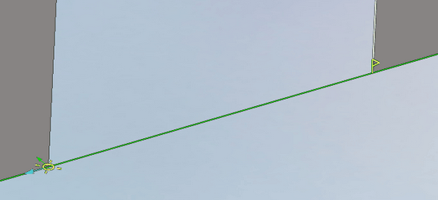

# 4Dジェットおよびワイヤー放電加工のジョブ割り当て

ワイヤー放電加工オペレーションのジョブ割り当てには、ジョブ割り当て項目のリストが含まれています。これらの項目には、加工形状および加工パラメータが含まれます。ジョブ項目は、簡易表示または詳細表示で確認できます。各項目は、１つの輪郭、または複数の輪郭を含むフォルダである場合があります。

簡易表示は、下図に示すようなジョブ割り当て項目のリストです。

`4D輪郭加工`では、2D輪郭を追加することができます。`2D輪郭加工` では、4D輪郭を追加することはできません。

以下の機能が利用できます。

- `ワイヤー放電2D要素` – 選択した項目を2Dジョブ割り当てとして追加します。
- `ワイヤー放電4D要素` – 選択した項目を4Dジョブ割り当てとして追加します。輪郭のうち1つが上輪郭として、もう1つが下輪郭として使用されます。このボタンは `4D輪郭加工`の場合のみ利用可能です。`4D輪郭加工`

- `プロパティ` – ジョブ割り当て項目のプロパティを詳細表示するウィンドウを開きます。一度に複数の項目を編集することもできます。項目を選択するには、Windowsの標準的なキー操作を使用します。
- `削除` – 選択した項目をリストから削除します。

パラメータウィンドウを開いたり、項目を削除したりするには、ポップアップパネルのボタンを使用することもできます。

複数の項目および[複数のパラメータを同時に選択](10235.md)することができます。

輪郭は、閉じた輪郭でも開いた輪郭でも構いません。輪郭の開始点と終了点は、グラフィックウィンドウで変更できます。

システムでは、グラフィックウィンドウ上で輪郭を直接編集できます。編集方法は、 [旋盤](10209.md)オペレーションで使用される方法と同様です。
