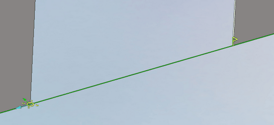

# Atribuição de trabalho de operações EDM e corte a jato 4D

A definição da tarefa das operações de eletroerosão a fio contém uma lista de itens da definição da tarefa. Esses itens são a geometria de usinagem e também os parâmetros tecnológicos. Os itens podem ser visualizados de forma resumida ou completa. Cada item pode ser um único contorno ou uma pasta que contém vários contornos.

A visualização resumida é uma lista de itens da definição da tarefa, mostrada abaixo:

A operação `4D Contouring` permite adicionar contornos 2D. A operação `2D Contouring` não permite adicionar contornos 4D.

As seguintes funções estão disponíveis:

- `Wire EDM item 2D` – adiciona o item selecionado como definição da tarefa 2D.
- `Wire EDM item 4D` – adiciona o item selecionado como definição da tarefa 4D. Um dos contornos será considerado o contorno superior, e o outro, o inferior. Esse botão está disponível apenas para [4D Contouring](10247.md)

- [Properties](10230.md) – abre uma janela com a visualização completa das propriedades do item da definição da tarefa. Vários itens podem ser editados ao mesmo tempo; para selecioná-los, use as combinações de teclas padrão do Windows.
- **Delete** – exclui os itens selecionados da lista.

Para abrir a janela de parâmetros e excluir itens, também é possível usar os botões do painel pop-up:

É possível [selecionar vários itens com vários parâmetros](10235.md).

O contorno pode ser fechado ou aberto. Os pontos inicial e final do contorno podem ser alterados na janela gráfica:

O sistema permite editar o contorno diretamente na janela gráfica. Os princípios de edição são semelhantes aos usados nas [operações de torneamento](10209.md).
