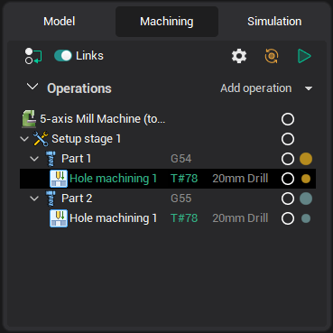
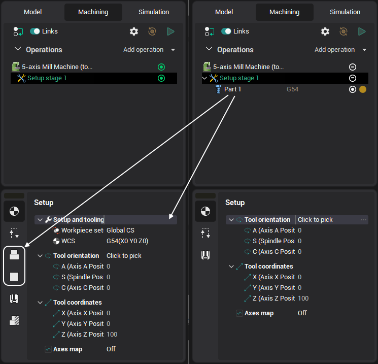

# Gruppo di struttura delle operazioni

## Ambito di applicazione:

Il gruppo è necessario per costruire un processo tecnologico.

## Particolarità di funzionamento:

I componenti inclusi nell'albero delle operazioni hanno una struttura gerarchica simile alla sequenza dei processi tecnologici. I nodi di tipo <strong>Part</strong> (pezzo) o <strong>Part Copy</strong> (copia del pezzo) sono annidati nel nodo <strong>Structures group</strong> (gruppo di struttura). A loro volta, il nodo <strong>Multiply Group</strong> (gruppo di moltiplicazione) è annidato nei nodi <strong>Part</strong> e <strong>Part Copy</strong>.

Di conseguenza, le operazioni si trovano all'interno di questi nodi.

Le schede presenti nei gruppi sono analoghe a quelle dell'elemento nell'albero dell'attrezzatura (Equipment). L'aggiunta di un nuovo sottogruppo nella struttura riduce il numero di schede del gruppo corrente, e il gruppo annidato eredita alcuni degli stessi parametri del gruppo principale. Tuttavia, questi parametri sono nascosti nel gruppo principale.

