# Proprietà degli elementi dell'assegnazione del lavoro 2D

Ogni elemento dell'assegnazione del lavoro ha un insieme di proprietà.

Per visualizzare o modificare le proprietà di un elemento dell'assegnazione del lavoro 2D, selezionare l'elemento e fare clic sul pulsante **Properties** oppure fare doppio clic sull'elemento.

Finestra di dialogo delle proprietà dell'elemento:


- **Top level** (livello superiore) – piano della guida superiore della macchina per elettroerosione. Per impostare il livello della guida superiore tramite la finestra grafica, spostare il simbolo del livello superiore:

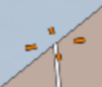

- **Bottom level** (livello inferiore) – piano della guida inferiore della macchina. Per impostare il livello della guida inferiore tramite la finestra grafica, spostare il simbolo del livello inferiore:

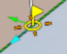 Per impostare il livello esatto della guida superiore o inferiore, fare clic sul simbolo del livello e inserire il valore: 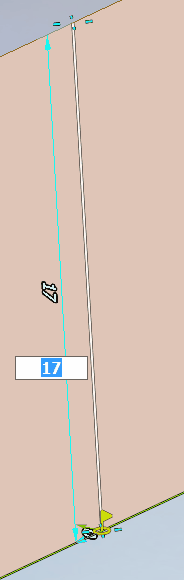

- **Profile stock** (sovrametallo sul profilo) – sovrametallo aggiuntivo per il profilo risultante. Il valore del sovrametallo può essere positivo o negativo.
- **Overlap before pass** (sovrapposizione prima della passata) – valore della sovrapposizione all'inizio dell'elemento dell'assegnazione del lavoro.
- **Overlap after pass** (sovrapposizione dopo la passata) – imposta il valore della sovrapposizione alla fine dell'elemento dell'assegnazione del lavoro.
- **Auto bridge count** (numero automatico di ponticelli) – numero di ponticelli. Le proprietà dei ponticelli possono essere impostate nella finestra grafica.
- **Taper parameters** (parametri di conicità) – se disattivati, il filo viene posizionato perpendicolarmente al piano XY e il risultato della lavorazione è una superficie cilindrica. Per lavorare una superficie conica, attivare la funzione e impostare il valore e la direzione dell'angolo di conicità per ciascun profilo. Per impostare l'angolo di conicità, fare clic sulla linea di sincronizzazione e inserire il valore.
- 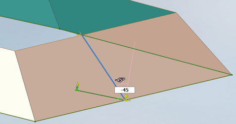 Quando la conicità è attivata, il valore dell'angolo di conicità viene emesso in ogni blocco NC (ad esempio `G01 X30 Y45 A5`). L'attivazione della funzione di conicità abilita parametri aggiuntivi.

- **Taper application** (applicazione della conicità) può assumere uno dei seguenti valori:

- **All passes** (tutte le passate) – la conicità viene applicata a tutte le passate dei profili.
- **Apply after pass** (applica dopo la passata) – la conicità viene applicata dopo il numero di passata impostato nel campo `Pass #`. La conicità è disattivata per le N passate; dalla passata N+1 in poi la conicità è attivata.
- **Cancel after pass** (annulla dopo la passata) – la conicità viene annullata dopo il numero di passata impostato nel campo `Pass #`. La conicità è attivata per le N passate; dalla passata N+1 in poi la conicità è disattivata.

- **Corners rolling** (arrotondamento degli spigoli) – I moderni controlli NC per elettroerosione supportano l'arrotondamento automatico degli spigoli vivi nel percorso del filo. Il sistema CAM può sfruttare questa funzione del controllo NC. Il pannello **Corners rolling** contiene le proprietà utilizzate per configurare la funzione di arrotondamento degli spigoli del controllo NC. Quando la funzione è attivata, le coordinate del profilo emesse nel programma NC restano invariate (il profilo non viene modificato). Tuttavia, nei blocchi NC in cui è richiesto l'arrotondamento degli spigoli vengono emesse parole aggiuntive che definiscono i raggi di arrotondamento. I raggi di arrotondamento possono essere definiti separatamente per il profilo superiore e per quello inferiore. Ad esempio, `G01 X95.24 Y53.09 R1.5 R5.3`: la prima parola **R** definisce il raggio di arrotondamento del profilo inferiore, la seconda parola **R** definisce il raggio di arrotondamento del profilo superiore, pari a 5.3.

Osservazione: la simulazione del sistema CAM supporta la visualizzazione del percorso del filo modificato dall'arrotondamento degli spigoli eseguito dal controllo NC.

Il sistema CAM supporta diverse modalità di arrotondamento degli spigoli, che possono essere impostate separatamente per gli spigoli interni (**Inner corners rolling**) e per quelli esterni (**Outer corners rolling**). Il fatto che uno spigolo sia interno o esterno è determinato dal valore dell'angolo all'interno del pezzo. Uno spigolo interno ha un angolo pari o superiore a 180°, uno spigolo esterno ha un angolo inferiore a 180°.

| **Spigolo interno** | **Spigolo esterno** |
|---|---|
| 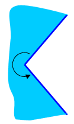 | 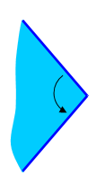 |

Sono supportate le seguenti modalità di arrotondamento:

- **Off** (disattivato) – in questa modalità la funzione di arrotondamento degli spigoli è disattivata e i raggi di arrotondamento non vengono emessi nel programma NC.

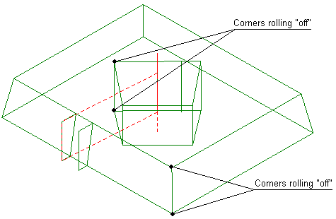

- **Sharp** (vivo) – in questa modalità vengono arrotondati solo gli spigoli del profilo inferiore, mentre gli spigoli del livello superiore non vengono arrotondati. Pertanto è abilitato solo il campo di immissione **Bottom radius**.

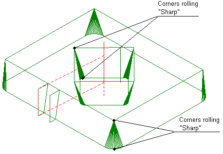

- **Conical** (conico) – in questa modalità il raggio di arrotondamento degli spigoli del profilo inferiore viene impostato nel relativo campo di immissione. Il raggio di arrotondamento del profilo superiore è definito come somma del raggio inferiore e di un valore che dipende dall'angolo di conicità e dalla differenza tra i livelli dei profili superiore e inferiore:

```
Rtop = Rbottom ± h · tg α
```

In questo modo, nel punto di arrotondamento dello spigolo viene lavorata sul pezzo una superficie conica.

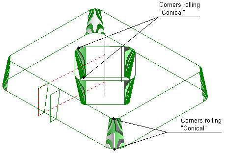

- **Cylindrical** (cilindrico) – il raggio di arrotondamento dello spigolo è sempre uguale per il livello superiore e per quello inferiore e viene inserito nel campo **Bottom radius**. In questo modo, nel punto di arrotondamento dello spigolo viene lavorata una superficie cilindrica.

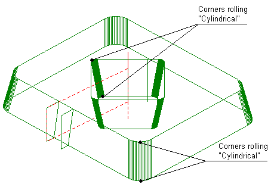

- **Fixed** (fisso) – i raggi di arrotondamento ai livelli superiore e inferiore sono definiti indipendentemente nei rispettivi campi e possono assumere valori positivi arbitrari.

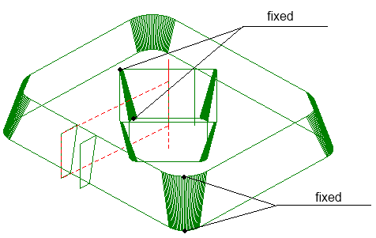

Utilizzare la seconda scheda della finestra di dialogo delle proprietà per specificare la direzione e il lato di lavorazione di ciascun elemento dell'assegnazione del lavoro.

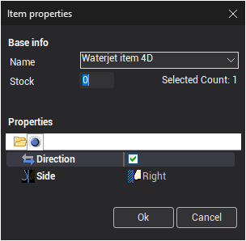

Nella finestra grafica la direzione è indicata da una freccia azzurra, il lato di lavorazione da una freccia verde lime.

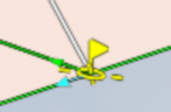

Questi parametri possono essere modificati tramite la finestra di dialogo delle proprietà oppure facendo clic sulla freccia nella finestra grafica.
