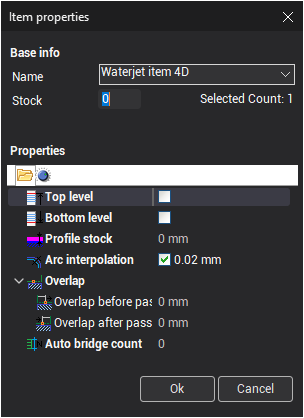
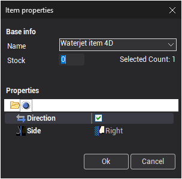

# 4Dジョブ割り当て項目のプロパティ

ジョブ割り当ての各要素には、一連のプロパティがあります。

4Dジョブ割り当て項目のプロパティを表示または編集するには、項目を選択して`プロパティ`ボタンをクリックするか、項目をダブルクリックします。

以下は項目のプロパティダイアログです。

すべてのプロパティは[2Dジョブ割り当て要素のプロパティ](10230.md)と同じです。

ダイアログの2番目のタブを使用して、各ジョブ割り当て項目の加工方向と加工側を設定します。

`方向`と`加工側`プロパティは [2Dジョブ割り当て要素のプロパティ](10230.md)と同じです。

- `チェーン入れ替え` –上部高さと下部高さを入れ替えます。
- `下部チェーン反転` –下部高さの輪郭の方向を反転させます。
- `上部チェーン反転` – 上側高さの輪郭の方向を反転させます。
