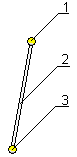
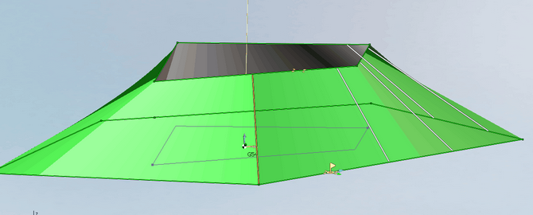
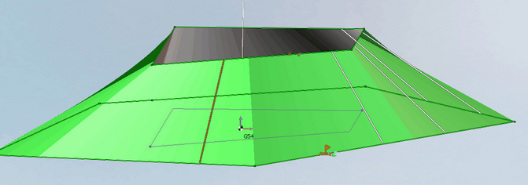

# 同期線

[ワイヤー放電2D輪郭加工](10246.md)のオペレーションでは、同期線は線で接続された2つの点として表示されます。同期線を使用して、[テーパー角度を定義](10230.md)することができます。

[ワイヤー放電4D輪郭加工](10247.md)オペレーションでは、同期線の移動に加えて、同期線の各点の位置も変更できます。線の位置を移動するには、マウスカーソルを線の中央（2）に合わせます。点の位置を移動するには、マウスカーソルをその点（1 または 3）に合わせます。

同期線はグラフィックウィンドウでコピーおよび削除できます。

コピーするには、対象を選択し、 [Ctrl] キーを押しながらマウスの左ボタンを押したまま、要素を目的の位置までドラッグします。

要素を削除するには、対象をクリックして選択し、 [Del]キーを押します。

新しい同期線を作成するには、ジョブ割り当て要素の折れ点（頂点）にマウスカーソルを合わせ、作成された線を目的の位置までドラッグします。

