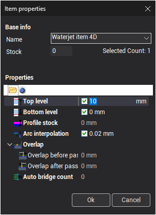

# マルチセレクト機能

共通の属性を持つ要素を選択するには、フローティングアクションバーを使用します。任意の要素を選択し、マルチセレクトオプションを有効にします。

ポップアップパネルには、選択した要素のプロパティが表示されます。チェックボックスを使用して、選択した要素のプロパティの値に基づいて選択対象を絞り込むことができます。プロパティにチェックを入れると、そのプロパティの値が等しい要素のみが選択されます。例えば、ストックが 0mm の要素をすべて選択したい場合は、そのような要素を1つを選択し、`仕上げ代`プロパティにチェックを入れます。
