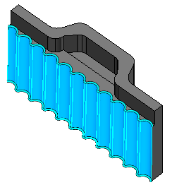
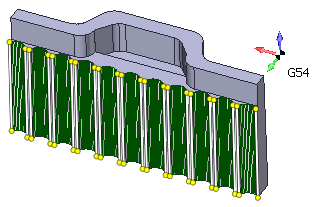

# Drahterodierfeature

Ein Drahterodierfeature besteht aus einer Kette von Regelflächen, deren obere und untere Kanten jeweils in horizontalen Ebenen liegen. Das System erkennt die beiden Konturen und ergänzt Synchronisationslinien an den zugehörigen Stellen.

 

Für eine neue Drahterodieroperation wählen Sie eine Fläche des gewünschten Merkmals und erstellen die Operation über das Menü von **New**. Das System erkennt das Merkmal, übernimmt es in die Auftragszuweisung und stellt die Parameter entsprechend ein.

Für eine vorhandene Operation wählen Sie eine zugehörige Fläche und klicken auf **Add cap** oder **Add hole**. War die Auftragszuweisung leer, werden die Operationsparameter anhand des Merkmals eingestellt.
