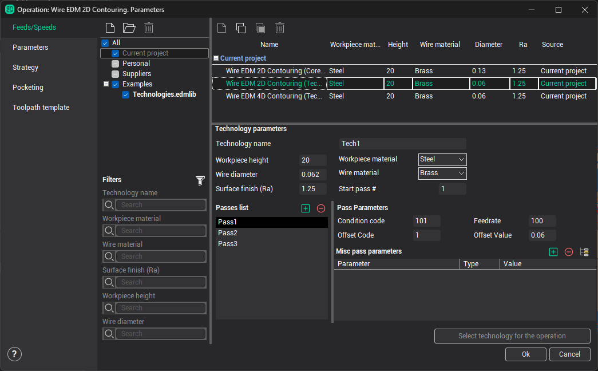
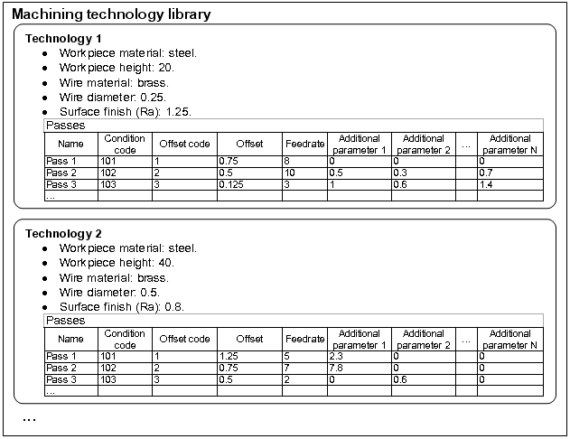

# ワイヤー放電および4Dジェット加工の加工条件

オペレーションパラメータウィンドウの送り速度/回転数ページでは、ワイヤー放電オペレーションの加工条件を指定できます。また、条件ライブラリを使用することもできます。

送り速度/回転数ページの左側のパネルには、ワイヤー放電ライブラリのストレージ（保存先）のリストが表示されます。ストレージには、ライブラリファイル(<strong>*.edmlib</strong>)または <strong>カレントプロジェクト</strong> があります。

ストレージはフォルダごとにグループ化されています。各項目の横にはチェックボックスがあります。これを切り替えることで、右側のパネルでこのストレージの表示/非表示を切り替えます。

上部のツールバーには以下のボタンがあります。

-  新規ライブラリ> –新しいライブラリを作成します。ファイル保存ダイアログが表示されますので、新しい*.edmlibファイルの保存先と名前を指定します。ライブラリはExamplesフォルダまたはSuppliersフォルダ以外に配置してください。これらのフォルダに配置すると、ライブラリは読み取り専用になります。
-  ライブラリを開く - 既存のライブラリをリストに追加します。標準のファイルを開くダイアログが表示されますので、*.edmlibファイルを1つ選択します。標準フォルダ($(COMMON_APPDATA)\Libraries\WireEDM)内に配置されているすべての*.edmlibファイルは、自動的にリストへ追加されます。
-  <strong>ライブラリを削除</strong> –選択したライブラリをリストから削除します。ハードディスク上のファイル自体が削除されるわけではありません。

現在のNC制御装置では、多様な加工条件の設定方法に対応していますが、その多くでは次のようなアルゴリズムを採用しています。同時に、多数のパラメータが存在し、それらによって特定の加工条件が定義されます。ワーク高さや材質、ワイヤー径および材質、および要求される表面粗さに応じて、所定の電力特性（周波数・電流値・ジェネレータ動作モードなど）、ワイヤー送り速度、およびワイヤーオフセットを設定できます。通常、機器メーカーは、あらかじめ定義された加工パラメータのテーブルをNC制御装置に組み込むか、このテーブルに値を入力・編集できる機能を提供しています。各パラメーターセットには、特定のコードが割り当てられており、Gコードを作成する際、対応するレジスタにこれらのコードを簡単に設定できます。NC制御装置は、コードと特定の加工パラメータを自動的に照合します。

特定のワークおよび装置パラメータ（ワーク材質と高さ、ワイヤーの材質と直径）に関連付けられた特定の加工条件のセット ( 電力・周波数・電流値・ジェネレーターの動作モード・オフセットなど) を<strong>マシニングテクノロジー(加工設定）</strong>と呼びます。

ウィンドウの右上には、左側のパネルで選択した保存先の加工設定のリストが表示されます。右下には、選択した加工設定のパラメータが表示されます。各ライブラリーには、加工設定のリストが含まれています。プロジェクトにはオペレーションのリストが含まれていますが、各オペレーションには1つの加工設定のみが含まれています。そのため、ライブラリーとオペレーションの両方の加工設定を1つのリストに表示できます。現在のオペレーションは、加工設定のリスト内で緑色で表示されます。

選択した加工設定を現在のオペレーションに適用するには、ウィンドウ右下の大きなボタンを使用します。この操作により、選択した加工設定のすべての内容が、現在のオペレーションの加工設定にコピーされます。

ウィンドウの中央上部にあるツールバーのボタンを使用して、加工設定を操作できます。

-  <strong>新しい加工設定</strong>– 新しい加工設定をリストに追加します。リストで読み取り専用の保存先（現在のプロジェクト、またはExamplesフォルダ内のライブラリ）が選択されている場合、この機能は利用できないことがあります。編集できるようにするには、任意のフォルダに独自のライブラリを作成してください。
-  <strong>加工設定</strong>をクリップボードにコピー – 加工設定をクリップボードにコピーし、他のライブラリに貼り付けられるようにします。
-  <strong>クリップボードから加工設定を貼り付け</strong> - クリップボードから選択したライブラリに加工設定を貼り付けることができます。ライブラリは読み取り専用でない必要があります。
-  選択した加工設定を削除 – 選択中の加工設定をリストから削除します。

各加工設定には、以下のプロパティがあります。

- 加工設定名 - 加工設定を一意に識別するテキストです。
- ワーク高さ - 加工するワークの高さです。
- ワイヤー直径 - 選択した加工設定で使用するワイヤーの直径です。
- サーフェス仕上げ（Ra） - 選択した加工設定によって得られるサーフェスの粗さです。
- ワーク素材 - 選択した加工設定が適用されるワークの材質です。
- ワイヤー素材 – 加工に使用するワイヤーの材質です。
- <strong>開始パス番号</strong> - 加工を開始するパスの番号です。デフォルト値は1です。 ただし、選択した加工設定で加工を行う必要があっても、最初から加工を開始しない場合もあります。 例えば、1つのパーツ領域の切断加工を複数のオペレーションに分割する場合に、このような必要が生じることがあります。 その場合、最初のオペレーションの方法では、加工設定に定義されているパス数より少ないパス数を指定します。 次のオペレーションでは、開始パスを1以外に設定します。 パスの番号を含む最も近いパスの順序は、オペレーションパラメータウィンドウの<strong>加工設定</strong>タブにある[パス表示リスト](10238.md)情報パネルに表示されます。
- パスリスト/パスパラメータ - 各パスごとの加工パラメータを含むパスのリストです。

パスとは、ワイヤーが輪郭に沿って行う 1 回の加工のことです。  ボタンを使用して、パスを追加または削除することができます。各パスには、以下のパラメータが設定されます。

- 条件コード – マシンごとの固有の値で、NC制御装置のレジスタ番号に対応します。このコードによって加工条件が定義されます。通常、C, E, Sのレジスタが使用されます。加工条件コードの詳細については、使用する機械のマニュアルを参照してください。
- オフセットコード – ワイヤーオフセット用レジスタの番号（補正半径の番号）です。詳細については、使用している機械のマニュアルを参照してください。
- オフセット値 – 選択したオフセットコードに対応するワイヤーオフセット値です。 この値には、ワイヤー半径、オーバーバーン値、および各パスごとの個別の残し代が考慮されます。 この値はポストプロセッサーに送られ、ワイヤーオフセットを制御するレジスタの初期化に使用できます。 通常、これらのレジスタには<strong>H</strong>およびDが使用されます。 オフセット値は、全体の残し代とともに[補正](10238.md)モデリングに使用されます。

- 送り速度 – ワイヤーの送り速度です。この値は、[システム設定](22.md)に応じて、分あたりミリメートル（mm/min）または分あたりインチ（in/min）で指定します。多くのワイヤー放電加工機では、送り速度 は使用されませんが、特定のNC制御装置で必要となる場合に備えて、この値を使用できます。また、この値は、システムによる切削時間の計算にも使用されます。

- その他パスパラメータ – パスの追加パラメータの配列です。 各パラメータは、パラメータ – タイプ – 値 の形式の行で表示されます。 パラメータ は、そのパラメータの説明テキストです。 タイプはパラメータの型で、整数または小数を指定できます。 値は、パラメータの数値です。このパラメータ配列およびパスのその他のパラメータは、PPFUN WEDMConditions(56) コマンドによってポストプロセッサーに送られ、それぞれの用途に応じて使用できます。 名前と値は、該当するセルをマウスでクリックして入力します。

-  パラメータ追加 – 選択したパスの追加パラメータのテーブルに新しい行を追加します。
-  パラメータ削除 – 追加パラメータテーブルから選択中の行を削除します。
-  ー選択したパスの追加パラメータテーブルを、現在の加工設定のすべてのパスにコピーします。

加工設定は、外部ソースからインポートしたり、CAMシステムの外部へエクスポートしたりできます。これを行うには、リストから目的の加工設定を選択し、右クリックして表示されるポップアップメニューから"<strong>選択した加工設定をXMLにエクスポート</strong>"を選択します。XML は構造化されたテキスト形式であり、任意のテキストエディターで編集したり、他のプログラムで処理したりできます。その後、対応するポップアップメニューを使用して、この XML を再度システムにインポートできます。

