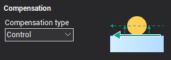
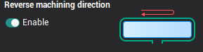
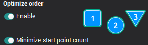
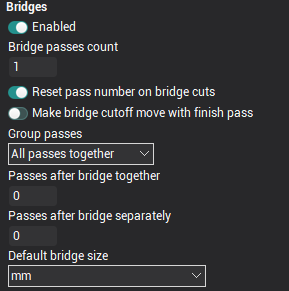
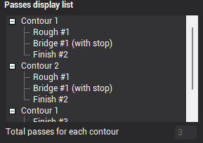
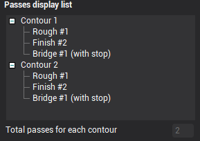
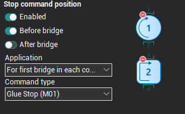
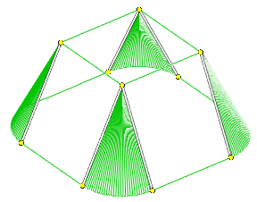
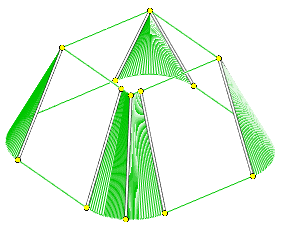

# ワイヤー放電および4Dジェット加工の加工設定

加工設定に関する多数のパラメータの変更は、 `パラメータ` –> `加工設定` ウィンドウで行います。このウィンドウは、加工モードにある `パラメータ` ボタンをクリックすると開きます。 `加工設定`タブには、入力フィールドと説明画像を含む複数のパネルがあります。これらのパネルの構成は、現在のオペレーションの種類によって決まります。

輪郭のワイヤー放電加工オペレーションには、以下のパラメータが含まれます。

- `補正タイプ` – 指定した輪郭に対してワイヤーのオフセットを行う方法を設定します。

以下の補正タイプが利用可能です。

- `コンピュータ` – システムが補正後のワイヤーツールパスを自動計算し、補正を有効にするコードは G コードに出力されません。補正を管理するレジスタには、オフセット値は入力されません。
- `制御機` – 補正を有効にするコードを G コードに出力しますが、ワイヤーのオフセットは行いません。補正値を管理するレジスタには、各パスのオフセット値が入力されます。補正はCNC制御装置によって計算されます。
- `両補正` – あらかじめオフセットを考慮したツールパスを G コードに出力すると同時に、補正を有効にするコードも G コードに出力します。補正値を管理するレジスタには値は入力されません。
- `両補正リバース` – `両補正` モードと同様に補正を計算しますが、補正の方向が逆になります。
- `オフ` – 輪郭に対して入力されたワイヤーオフセット値は出力されません。補正コードもGコードに出力されません。補正量を管理するレジスタは使用されません。

各パスの補正量は、`オフセット値`タブに設定された`送り速度/回転数` に、オペレーションの残し代の値を加えたものとして定義されます。補正タイプが `コンピュータ`, `両補正`, `両補正リバース` の場合、この値は等距離パスの作成に使用されます。 `制御機`タイプの場合は、この値が`オフセット値`で該当するパスに指定された`送り速度/回転数`と同じ番号のレジスタに入力されます。

補正の方向は、オペレーションの`ジョブ割り当て`内で、輪郭ごとに個別に設定できます。

- `逆加工方向` –このオプションを有効にすると、システムはツールパスの長さが最短になる方向を、そのパスの加工方向として選択します。このオプションを無効にすると、パスの方向は常に、輪郭の`ジョブ割り当て`で指定された方向になります。

- `最適化順序` – ジョブ割り当てに複数の輪郭が含まれている場合に、輪郭を加工する順序を設定する方法です。`最適化順序`オプションを有効にすると、輪郭間の移動距離が最短になるようにツールパスが自動的に最適化されます。このオプションを無効にすると、パスの加工順序は `ジョブ割り当て`で設定された輪郭の順序に従います。

- `ブリッジ前のパス` ジョブ割り当て内の各輪郭に対してブリッジをトリムするために実行するパス回数を設定します。ブリッジの生成が無効になっている場合、これらのパラメータは各輪郭の総パス数を設定します。 `荒取りパスを実行` オプションを有効にすると、各輪郭に対して荒取りパスが1回実行され、さらに`仕上げパス回数`フィールドで指定した回数の仕上げパスが実行されます。このオプションを無効にすると、ブリッジをトリムする前の荒取りパスおよび仕上げ加工パスは実行されません。おおよそのパスの順序は、`パス表示リスト`に表示される設定パラメータに基づいて決まります。

- `ブリッジ`例えば、ジョブ割り当てが一連の閉じた輪郭で構成されている場合などでは、輪郭全体を一周すべて加工すると、ワークの一部が意図せず残留・落下することがあります。システムには、ワーク上の特定区間を未加工のまま残すためのパラメータが用意されており、これらの未加工部分を ブリッジと呼びます。 ワイヤがこのようなゾーンに接近すると、システムは `停止指令位置`を追加してワークの一部を固定するための追加工程を行うことができ、その後、ブリッジは自動的にトリミングされます。 ブリッジの位置は、`ジョブ割り当て`セクション内で、輪郭ごとに個別に指定できます。 `ブリッジ`セクションでは、ブリッジ切断用のパス回数、ブリッジ切断後に輪郭を仕上げるパス回数、およびこれらパスの実行順序を決定する各種パラメータを設定できます。 `有効`が選択されていない場合、ブリッジの切断およびブリッジ切断後の仕上げ加工は行われません。そのため、本パネル内のすべてのフィールドは使用不可となります。

`ブリッジパス回数`フィールドでは、各輪郭上の各ブリッジを切断する際に実行するパス回数を設定します。

`ブリッジ加工のパス回数をリセット`オプションを有効にすると、ブリッジ切断動作に適用される切削条件を定義するパス番号のカウントが初期値にリセットされます。つまり、 `送り速度／回転数`タブの `開始パス番号`フィールドで設定された値にリセットされます。例：ブリッジ切断前の最後の輪郭パスが #2 の場合、最初のブリッジ切断パスは #3、次は #4 ……というように連番で続行されます。

`ブリッジの切り落とし動作を仕上げパスで実行` オプションを有効にすると、最終仕上げパス中にブリッジを切断し、その後に退出動作を行います。さらに、ブリッジパス回数 が 2 回以上に設定されている場合は、続いて残りのブリッジ切断パスを実行しれます。このオプションを無効にした場合、最後の輪郭パスではブリッジを残したまま退出動作が行われ、その後にブリッジ切断動作を実行します。

`ブリッジ後のパスをまとめて実行`と`ブリッジ後のパスを別に実行`の各フィールドは、ブリッジ切断後に各輪郭の全長に沿って「クリーンアップ」パスとして実行される仕上げパスの回数を決定します。これら2つのオプションの違いは、輪郭フィーチャが複数ある場合にのみ影響します。両タイプの最終仕上げパスの実行順序の例を以下の図にします。

| まとめパスの実行順序： | 個別パスの実行順序： |
|---|---|
|  |  |

`グループパス` のドロップダウンメニューでは、複数の輪郭を加工する際に、異なる種類のパスをどのようにグループ化して実行するかを選択できます。以下のオプションが用意されています。

- `全てのパスをまとめて実行` –各輪郭ごとに、荒取りパス、ブリッジ切断パス、および仕上げパスのすべてを連続して実行し、当該輪郭の加工がすべて完了してから次の輪郭の加工を開始します。
- `ブリッジと仕上げ` –先にすべての輪郭に対して荒取りパスを実行し、その後、各輪郭ごとにブリッジ切断パスと仕上げパスをまとめて実行します。
- `荒取り、ブリッジ、仕上げ` - まず、すべての輪郭についてブリッジ切断を行わずに荒取りパスを実行し、次にすべての輪郭について仕上げ加工を行わずにブリッジ切断を実行し、最後にすべての輪郭に対して仕上げ加工パスを実行します。

`パス表示リスト` には、設定したパラメータに応じたおおよそのパス順序が表示されます。

- `パス表示リスト` ワイヤ放電加工（Wire EDM）の `加工設定` タブには、ジョブ割り当て内の輪郭を加工する方法や加工順序を制御する多数のオプションが用意されています。特定のパラメータが加工順序にどのような影響を与えるかを分かりやすく確認するために、`パス表示リスト` という情報パネルが用意されています。加工方法プロセスに影響する値またはパラメータを変更すると、それに応じてこの情報パネルの内容も更新されます。このパネルのメイン表示エリアは、2階層のツリー形式 で表示されます。このツリー表示では、上位階層に輪郭が表示され、下位階層には加工条件を定義するパスの種類およびパス回数が表示されます。パネル下部には、現在の設定に基づいて各輪郭に対して実行される総パス数を表示するボックスがあります。

<em>注意： `パス表示リスト` の情報パネルは情報を表示するだけのものであり、すべてのフィールドは読み取り専用です。表示内容を変更するには、メインウィンドウにある各種パラメータオプションを使用する必要があります。</em><em>パネルに表示される情報はあくまで概略であり、実際の加工順序と一致しない場合があります。これは、表示内容を生成する際に、<em>オペレーションのジョブ割り当てに含まれる輪郭の実際の形状が考慮されていないためです。</em></em><em>デフォルトでは、このリストには常に 2つの抽象的な輪郭 が含まれます。</em>

<em>注意： 加工方法でパス回数を指定する際は、`各輪郭の合計パス` フィールドのパス数が、< [送り速度／回転数](10237.md) タブの切削条件で定義されているのパス数と一致していることを十分に確認する必要があります。パス回数が一致していない場合、加工完了後に輪郭上に材料が残ることがあります。

- `停止指令位置` このパネルのオプションでは、ブリッジ切断パスにおける停止コマンドのGコードへの出力を制御できます。停止コマンドは、`有効`オプションが選択されている場合にのみGコードへ出力されます。 次の2つのパラメータでは、停止コマンドを出力するタイミングを設定します。 `ブリッジ前` オプションを有効にすると、ブリッジへのアプローチ動作後、ブリッジを切断する前に停止コマンドが出力されます。 `ブリッジ後` オプションを有効にすると、ブリッジの切断後、終点からワイヤー切断点への退出動作を行う前に停止コマンドが出力されます。 これらのパラメータはそれぞれ独立して機能するため、同時に設定することが可能です。

`適用`のドロップダウンリストでは、ブリッジに対して加工停止をどのように適用するかを設定します。以下のオプションがあります。

- `全てのブリッジ` – オペレーションで指定されているすべてのブリッジについて、ブリッジ切断動作時に停止コマンドを出力します。
- `各輪郭の最初のブリッジ` – 各輪郭の最初のブリッジに対してのみ、停止コマンドを出力します。
- `オペレーションの最初のブリッジ` – オペレーション内の最初のブリッジを切断するときにのみ、停止コマンドを出力します。

`コマンドタイプ` このパラメータは、出力する停止コマンドの種類を指定します。次の2つの値があります。

- `グルー停止（M01）` – 「オプション」または「追加」の停止コマンドです。通常の停止コマンド（M00）とは異なり、CNC操作パネルのスイッチが有効な場合にのみ出力され、加工を停止するかどうかをオペレータが選択できます。通常、このコマンドは補助コード `M01` に対応します。
- `停止（M00）` – Gコードの実行を無条件に中断するコマンドです。通常、補助コード `M00` に対応します。

- `フレームの修正` この機能は、`ワイヤー放電4D輪郭加工` オペレーションで使用できます。指定した輪郭の一部が、ほぼゼロ、またはゼロの長さになる場合があります。下図の例では、左側図の下側輪郭にある円弧によって、上側輪郭の形状がゼロまで縮退しています。CNC制御は、縮退フレームにおいて、例えばオフセットパスを計算するために必要な幾何学的情報を得られないため、このようなケースを処理できないことがよくあります。そのため、このような状態は避ける必要があります。これに対処するには、 [ジョブ割り当て](10229.md) で対応関係を手動で指定する方法と、縮退フレームの補正機能を使用する方法があります。後者の場合、システムは輪郭上の極めて短い部分を自動的に検出し、下の右図に示すように、任意の長さだけその部分を「延長」します。

| 縮退フレームによる輪郭： | フレーム補正後の輪郭： |
|---|---|
|  |  |

`フレームの修正` セクションでは、この機能の有効／無効を切り替え、縮退した要素を延長する量を入力できます。`クリアランス`ドロップダウンリストには、以下の項目があります。

- `オフ` – この項目を選択すると、縮退フレームの補正を無効にします。
- `距離` – この項目を選択すると、この機能が有効になります。必要な延長量を固定値として`値`フィールドに入力します。入力する値は、現在選択されている単位（ミリメートルまたはインチ）に基づきます。
- `% (ワイヤー径)`- この項目を選択すると、この機能が有効になります。必要な延長量を、現在のワイヤー径に対する割合（%）として`値`フィールドに入力します。入力する値は、現在選択されている単位（ミリメートルまたはインチ）に基づきます。
