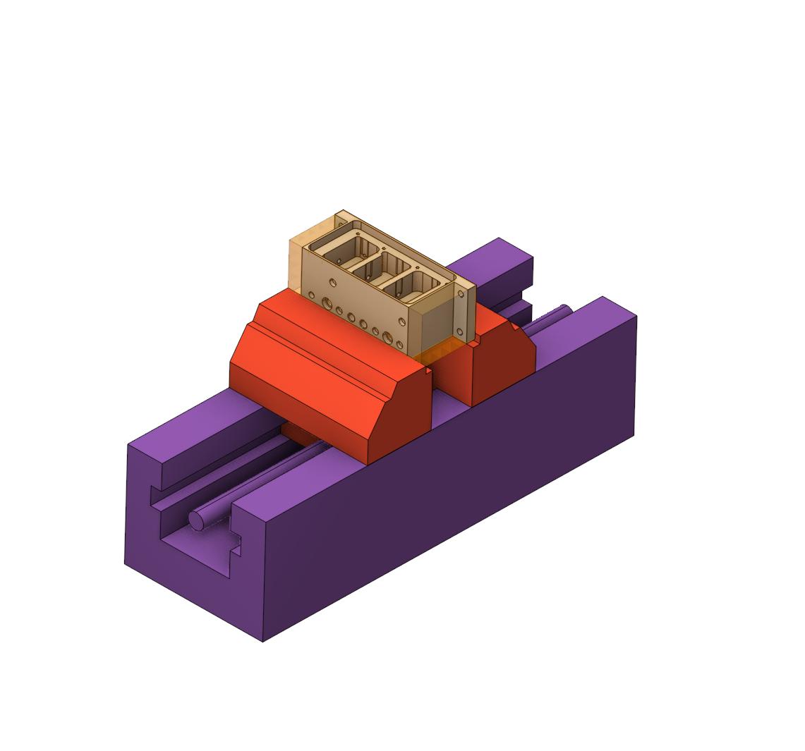
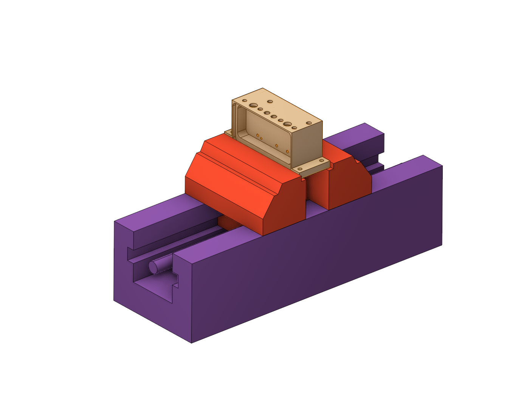

# Aufspannung

 

## Anwendungsbereich:

Diese Gruppe definiert eine Aufspannung. Dadurch kann das Bauteil von verschiedenen Seiten bearbeitet werden. Bauteil, Rohteil und weitere Elemente vorheriger Aufspannungen werden ausgeblendet, sodass sie nachfolgende Aufspannungen nicht beeinträchtigen.

Der Gruppe können Spannmittel hinzugefügt werden, die in ihren Untergruppen **Part** und **Copy of part** berücksichtigt werden.

## Einrichtung:

Auf der Registerkarte **Setup** werden grundlegende Projektparameter festgelegt, beispielsweise die Bauteillage auf der Maschine und das Werkstückkoordinatensystem. [Details](1022.md)

## Transformationen:

Diese Parameter ermöglichen Koordinatentransformationen des innerhalb einer Operation berechneten Werkzeugwegs. [Details](10168.md)
