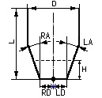

# 切断工具 - "ナイフ"

ナイフの寸法は、7つのパラメータで定義されます。

<strong>RD</strong> -工具先端から右側の切れ刃までの距離 <strong>LD</strong> -工具先端から左側の切れ刃までの距離 <strong>RA</strong> -右側の切れ刃の傾斜角度 <strong>LA</strong> -左側の切れ刃の傾斜角度 <strong>D</strong> - 刃幅 <strong>L</strong> - 刃長 <strong>H</strong>- デフォルトの切り込み深さ。この値は、ナイフ工具ごとに一定であるため、工具データベースに保存されます。

ナイフの厚みは、計算時には使用されません。ナイフの厚みは、表示用として自動的に計算されます。
