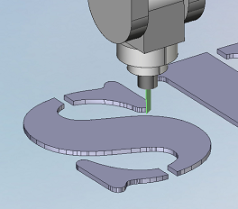

# 2Dナイフ切断

ナイフ切断2Dオペレーションは、板状ワークの切断加工をプログラミングするために設計されています。この操作は、[2D輪郭加工](404.md)に基づいています。

[「加工プロファイルの定義方法」](707.md)および本章で説明されていないその他のパラメータについては、[2D輪郭加工](404.md)オペレーションの説明に記載されています。

[ナイフ](10240.md)加工を使用する場合は、機械に対して追加の要件があります。機械には、直線の X、Y、Z 軸に加えて、工具を回転させる追加の回転軸が必要です。この回転軸は、機械構成内に定義されている必要があります。この軸がない場合、生成されるツールパスは正しくなりません。

鋭角コーナーにおけるナイフの挙動は、 "[コーナー退避](10243.md)"パラメータによって設定されます。
