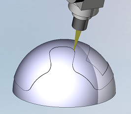

# 6Dナイフ切断

6Dナイフ切断オペレーションは、空間内の曲面上で切断加工を行うために設計されています。これは、[5D輪郭加工](10129.md)をベースにしています。

[「加工プロファイルの定義方法」](https://confluence.encycam.com/pages/viewpage.action?pageId=128547903)および本章で説明されていないその他のパラメータについては、[5D輪郭加工](10129.md)オペレーションの説明に記載されています。

ツールパス上のすべての点で、ナイフの刃は移動方向に沿って向けられている必要があります。そのため、6自由度すべてが必要です。したがって、使用するマシンには最低でも3つの直線軸と3つの回転軸を備えている必要があります。ナイフ切断には、産業用ロボットが使用されることが多くあります。機械構成がすべての自由度に対応していない場合、生成されるツールパスは正しくなりません。

鋭角コーナーにおけるナイフの挙動は、 "[コーナー退避](10243.md)"パラメータによって設定されます。
