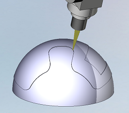

# Taglio con coltello 6D

L'operazione "Knife cutting 6D" (taglio con coltello 6D) è destinata all'incisione su superfici spaziali sagomate. Si basa sull'operazione "[contornatura 5D](10129.md)".

Il "[metodo di definizione dei profili di lavorazione](10132.md)" e gli altri parametri non descritti in questo capitolo sono riportati nella descrizione dell'operazione [contornatura 5D](10129.md).

In ogni punto del percorso utensile la lama del coltello deve essere orientata lungo la direzione del movimento. Ciò richiede tutti i 6 gradi di libertà. La macchina attiva deve quindi disporre di almeno tre assi lineari e tre assi rotativi. Per il taglio con coltello si utilizzano molto spesso robot industriali. Se lo schema cinematico della macchina non supporta tutti i gradi di libertà, il percorso utensile generato risulterà errato.

Il comportamento del coltello negli spigoli vivi è definito dal parametro "[corner retraction](10243.md)" (retrazione dello spigolo).
