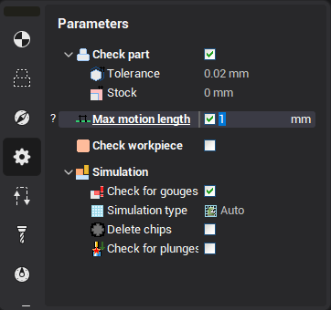

# Retração da faca nos cantos

Em cada ponto do percurso da ferramenta, a lâmina da faca é girada para ser direcionada ao longo do movimento. A rotação máxima em um corte é limitada pela "rotação máxima de movimento". A transição máxima também é limitada pelo "comprimento máximo do movimento". (veja a figura abaixo)

Se o movimento precisar de mais rotação, serão gerados alguns blocos para girar a ferramenta no ponto.
