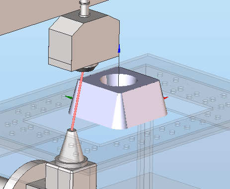

# ワイヤー放電加工

ワイヤー放電加工の基本原理は、ワイヤーとワーク（電極）の間に 50Hz から数百kHzの周波数でパルス電流を流すことで発生する放電（スパーク）をパーツに作用させることです。ワークとワイヤーの間は、絶縁液（誘電体液）によって隔てられています。放電の結果、ワイヤーとワークから微粒子が除去され、絶縁液の流れによって放電ギャップから排出されます。さらに、絶縁液は分解触媒の役割も果たします。放電による高温下で放電ギャップ周辺の絶縁液が気化し、即座に逃げ場を失った蒸気が、付加的な「マイクロ爆発」を引き起こします。

物理化学の観点では、高温によりワークの結晶格子が破壊され、金属イオンが表面との結合を失います。このプロセスは、帯電したワイヤーが金属を侵食しながら、ゆっくりとワークの中へ沈み込んでいくように見えます。真鍮ワイヤーがワークに切り込みを作り、必要な輪郭を形成します。

ワイヤ放電加工は、材料の無駄が多くなる場合や、加工が困難な金属（硬化鋼など）を加工する場合など、従来の加工方法では加工が困難または経済的でない場合に使用されます。

CNCワイヤー放電加工機は、放電加工によって板状の金属を切断するために使用されます。2軸または4軸の機械があり、側面が垂直またはテーパー状の曲線輪郭を切断できます。

CAMシステムでは、2軸または4軸のワイヤー放電加工機用のNCプログラムを作成できます：

- [ワイヤー放電2D輪郭加工](10246.md)
- [ワイヤー放電4D輪郭加工](10247.md)

輪郭加工オペレーションは、2軸輪郭加工では1つの2D輪郭に沿って、4軸輪郭加工では上側と下側の2つの輪郭に同時に沿って、ワイヤーパスの生成に使用します。また、1つのオペレーションで複数の輪郭を加工することもできます。加工に必要な輪郭のリストは、[ジョブ割り当て](10229.md)で選択します。ジョブ割り当てでは、必要な加工方向を指定することもできます。補正方向は、輪郭の種類と加工方向に応じて自動的に計算されます。各輪郭に対して、加工の開始点と終了点、ワイヤ装填点、ワイヤ切断点、テーパ角度などを設定できます。

各輪郭の開始点と終了点に対して、追加のアプローチ動作と退避動作を作成できます。これらの追加移動を使用することで、開始点と終了点を正しく加工することができます。アプローチおよび退避の方法とそのパラメータは、 [進入/退出](10233.md)ページで設定します。

良好な表面仕上げを得るために、輪郭に沿って複数回のパスを行う必要がある場合があります。CAMシステムでは、荒取り、仕上げ、ブリッジ、切断など、これらのさまざまなパス方法を使用できます。これらのパスの有効／無効の切り替え、および追加パラメータの設定は、オペレーションパラメータウィンドウの[加工設定](10238.md)ページで行います。この目的のために、パス方向の最適化、補正タイプの選択など、さまざまなオプションを使用できます。

最新のワイヤ放電加工機のCNC装置の多くでは、輪郭に沿った各パスについて、あらかじめ設定された切削条件のテーブルをCNC装置に読み込むことができます。加工中は、その切削モードに対応する特定の指令をGコードに含めることによって、テーブル内のいずれかの条件セットが選択されます。CAMシステムは、ワイヤー放電加工において、この切削モードの設定方法をサポートしています。これらの加工条件テーブルの変更は、オペレーションパラメータウィンドウの[送り速度設定](10237.md) ページで行います。このページでは、ワイヤーオフセット値やその他のパラメータ（ワークの高さと材質、ワイヤーの直径と材質、要求される表面粗さなど）を含め、各パスの加工条件を編集できます。加工条件のテーブルは、加工技術ライブラリーから選択することも、各オペレーションで個別に定義することもできます。マシニングテクノロジーライブラリのオペレーションも、同じウィンドウ内の別のタブで行います。

各オペレーションの固有のプロパティは、オペレーションパラメータウィンドウのパラメータ で設定します。そのため、このウィンドウの表示内容は、 [ワイヤー放電2D輪郭加工](10246.md)と[ワイヤー放電4D輪郭加工](10247.md)で見た目が異なります。

同じ種類の穴や溝など、同一要素が繰り返されるパーツを加工する場合は、変換を使用することを推奨します。これにより、計算時間を短縮し、NCデータのデバッグに必要な時間も削減できます。この機能は、オペレーションパラメータウィンドウで使用可能です。
