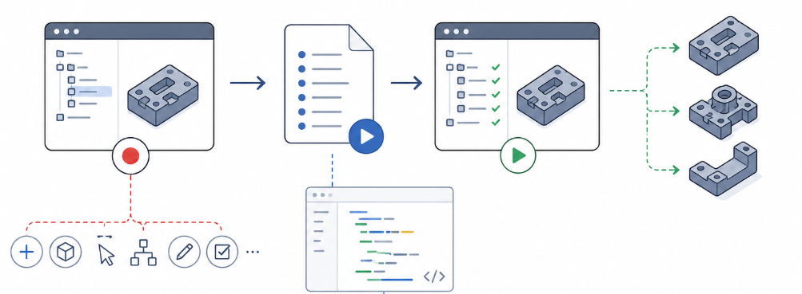
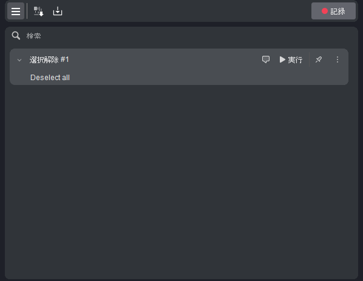

# Macro

## 

## Application area:

A **macro** is intended for recording a sequence of actions performed on a project and replaying it on demand. A sequence recorded once — creating operations, assigning geometry, selecting items in the model tree, editing properties — is converted by the system into a small, runnable extension that reproduces those actions whenever required. **A macro is also the fastest way to create a custom extension**: a working source code is generated from the recorded macro and serves as a template for further development.

**Macros are launched** from the **Utilities button on the main panel**.

Macros are used wherever the same work is performed repeatedly:

- applying a standard sequence of operations to similar parts;

- re-creating a typical machine, workpiece, and strategy setup at the start of a project;

- assigning the same geometry — faces, zones, curves, holes — in a uniform manner;

- sharing a repeatable procedure with other members of the team.

### The Macro panel:

The Macro panel contains the saved macros and the tools for recording new ones. The panel is divided into three zones (top to bottom): a **toolbar** with the recording controls, a **Search** field, and the **list of saved macros**.

**Toolbar buttons.**

**List toggle (≡)**. Shows or hides the list of saved macros.

**Project state**. Determines which parts of the current project — machine setup, workpiece and stock, strategy parameters — are captured by the macro at the start of recording.

**Record.** Starts recording a new macro; pressing it again stops the recording. [Details](102457.md)

**Search field.** It allows you to find a macro in the list.

**The macro list.**

**Name.** The macro name.

**Comment icon.** Displays the macro description on hover.

**Run.** Plays the macro. [Details](102460.md)

**Pin.** Keeps the macro at the top of the list.

**"…" menu**. Per-macro actions:

-  **Open in editor.** Opens the generated source code of the macro for reading or manual extension. [Details](102462.md)

-  **Edit.** Re-opens the macro steps with the full set of editing controls; saving the changes rebuilds the macro. [Details](102458.md)

- **Export.**

-  **Pin to top.** Pins the macro to the top of the list, above the separator line; selecting it again unpins the macro.

-  **Delete.** Removes the macro and its files. Unavailable while any macro is running.

**→**. Reveals the individual steps of the macro.

> ##### Macro storage
>
> Each macro is placed in its own folder inside the personal CAM system folder, under `macros`. The folder contains the generated source code and a human-readable list of the macro steps, which allows the macro to be copied together with that folder.
