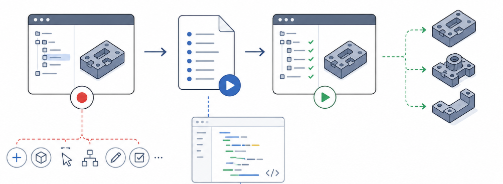
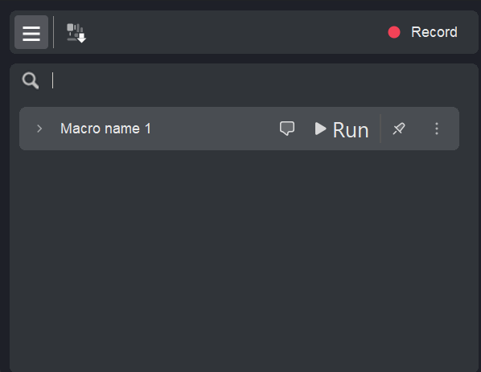

# Makros

## Anwendungsbereich:

Ein **Makro** zeichnet eine Folge von Projektaktionen auf und führt sie bei Bedarf erneut aus. Dazu gehören beispielsweise das Erstellen von Operationen, Geometriezuweisungen, Auswahlen im Modellbaum und Eigenschaftsänderungen. Das System erzeugt daraus eine ausführbare Erweiterung. Der generierte Quellcode kann außerdem als Vorlage für eine eigene Erweiterung dienen.

Makros werden über **Utilities** auf der Hauptleiste aufgerufen.

Typische Anwendungen:

- Standardfolgen auf ähnliche Bauteile anwenden;

- Maschine, Rohteil und Strategieparameter am Projektanfang wiederherstellen;

- Flächen, Zonen, Kurven und Bohrungen einheitlich zuweisen;

- wiederholbare Abläufe im Team austauschen.

### Makropanel

Das Panel enthält oben die Aufzeichnungswerkzeuge, darunter **Search** und die Liste gespeicherter Makros.

**Symbolleiste**

**List toggle (≡).** Blendet die Makroliste ein oder aus.

**Project state.** Legt fest, welche Teile des Projektzustands am Aufzeichnungsanfang übernommen werden, etwa Maschineneinrichtung, Rohteil und Strategieparameter.

**Record.** Startet und beendet eine neue Aufzeichnung. [Details](102457.md)

**Search.** Sucht ein Makro in der Liste.

**Makroliste**

**Name.** Makroname.

**Kommentarsymbol.** Zeigt beim Überfahren die Beschreibung.

**Run.** Führt das Makro aus. [Details](102460.md)

**Pin.** Hält das Makro oben in der Liste.

**Menü …** bietet:

- **Open in editor.** Öffnet den Quellcode zum Lesen oder Erweitern. [Details](102462.md)

- **Edit.** Öffnet die Schritte zur Bearbeitung. Beim Speichern wird das Makro neu erstellt. [Details](102458.md)

- **Export.**

- **Pin to top.** Fixiert den Eintrag oberhalb der Trennlinie oder hebt die Fixierung wieder auf.

- **Delete.** Entfernt Makro und Dateien. Während einer laufenden Makroausführung ist dies nicht verfügbar.

**→** zeigt die einzelnen Schritte.

> **Speicherort**
> Jedes Makro liegt in einem eigenen Unterordner von `macros` im persönlichen CAM-Systemordner. Dieser enthält Quellcode und lesbare Schrittliste. Zum Übertragen wird der vollständige Ordner kopiert.
