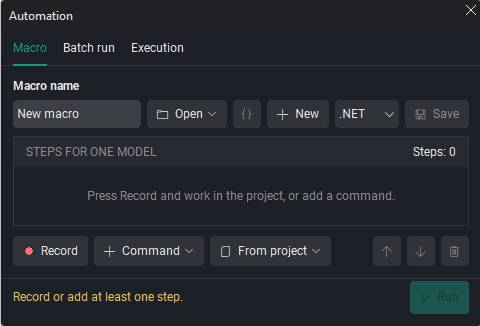

# Macro

## 

## Application area:

A **macro** is intended for recording a sequence of actions performed on a project and replaying it on demand. A sequence recorded once — creating operations, assigning geometry, selecting items in the model tree, editing properties — is converted by the system into a small, runnable extension that reproduces those actions whenever required. **A macro is also the fastest way to create a custom extension**: a working source code is generated from the recorded macro and serves as a template for further development.

**Macros are launched** from the **Utilities button on the main panel**.

Macros are used wherever the same work is performed repeatedly:

- applying a standard sequence of operations to similar parts;

- re-creating a typical machine, workpiece, and strategy setup at the start of a project;

- assigning the same geometry — faces, zones, curves, holes — in a uniform manner;

- sharing a repeatable procedure with other members of the team.

### The Macro panel:

The **Macro** tab of the **Automation** window is used to create, record, edit and run macros. The macro name and file controls are at the top, the step list is in the centre, and the controls for adding steps and running the macro are at the bottom.

**Macro name.** The name of the new or opened macro.

**Open.** Opens a saved macro to work with its steps.

**Code editor ({}).** Opens the macro source code. [Details](102462.md)

**New.** Starts a new macro.

**Language (.NET).** Selects the language used to create the macro: **.NET** or **Spr**.

**Save.** Saves the macro with the specified name and selected language. [Details](102459.md)

**Steps for one model.** Contains the macro's sequence of actions. The counter on the right shows the number of steps. [Details](102458.md)

**Record.** Starts recording actions in the project; pressing it again stops recording. [Details](102457.md)

**Command.** Adds a step manually. The menu contains:

- **Project commands.** **Create new project**, **Import 3D model**, **Create operations**, **Calculate operations**, **Output NC program**, **Save project**.
- **Variables, loops and conditions.** **Variable** defines a variable, **For each** adds a loop, **If** and **Else** add conditional branches, and **End** closes a block.

**From project.** Adds data from the current project and opens additional tools:

- **Machine setup.** Adds the current machine setup.
- **Setups & workpiece.** Adds the current project's setups and workpiece.
- **Operations parameters.** Allows project operations to be selected for adding their parameters to the macro.
- **Recognize feature.** Starts feature recognition.
- **Ask CAM Agent.** Opens CAM Agent.

**Up and down arrows.** Move the selected step in the list.

**Delete.** The trash button removes the selected step.

**Run.** Executes the macro. If running is unavailable, a message at the bottom explains why, for example that at least one step must be recorded or added. [Details](102460.md)

> ##### Macro storage
>
> Each macro is placed in its own folder inside the personal CAM system folder, under `macros`. The folder contains the generated source code and a human-readable list of the macro steps, which allows the macro to be copied together with that folder.
